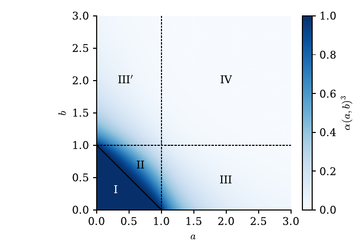

*This page is the full text of the paper. The typeset version is the PDF linked above. The note was developed in collaboration with an AI assistant (Claude, Anthropic), which carried out derivations, computations and drafting under the author's direction; see the [Acknowledgments](#acknowledgments).*

## Introduction {#sec-intro}

A matrix is invertible exactly when its rows are linearly independent, i.e. when $\det M\neq 0$. A natural first question about "random matrices" is therefore: *if the entries are chosen at random, what is the probability that $\det M = 0$?*

The answer depends entirely on where the entries come from.

- **Continuous entries.** If the entries are independent with any distribution that has a density (uniform on $[0,1]$, Gaussian, …), then $M$ is invertible with probability $1$. The singular matrices form the zero set of the polynomial $\det$, a hypersurface of Lebesgue measure zero in $\R^{n^2}$.
- **Finite fields.** Over $\mathbb{F}_q$ the classical count gives $\Pr[\text{invertible}]=\prod_{k=1}^{n}(1-q^{-k})$, which tends to a positive constant ($\approx 0.289$ for $q=2$) rather than to $1$.
- **Small integer alphabets.** For $\{0,1\}$ or $\{\pm1\}$ entries, the singularity probability is positive and decays exponentially in $n$. This is a celebrated line of work [\[16, 11, 22, 23, 10\]](#references).
- **Integer entries from a growing range.** If the entries are uniform on $\{1,\dots,N\}$ with $n$ fixed, the singularity probability tends to $0$ as $N\to\infty$, but never vanishes. This is the regime we study.

@tbl-mc illustrates how strongly the answer depends on the alphabet, even at $n=10$.

| Entries of a $10\times 10$ matrix | $\Pr[\text{invertible}]$ | Method |
|:--|:-:|:-:|
| any continuous distribution | $1$ | exact |
| $\{0,1\}$ over $\mathbb{F}_2$ | $\prod_{k=1}^{10}(1-2^{-k})\approx 0.289$ | exact |
| $\{\pm 1\}$ | $\approx 0.627$ | Monte Carlo, $2\times10^5$ samples |
| $\{0,1\}$ | $\approx 0.704$ | Monte Carlo, $2\times10^5$ samples |
| $\{1,2\}$ | $\approx 0.788$ | Monte Carlo, $2\times10^5$ samples |
| $\{1,2,3\}$ | $\approx 0.9940$ | Monte Carlo, $2\times10^5$ samples |
| $\{1,\dots,5\}$ | $\approx 0.99998$ | Monte Carlo, $2\times10^5$ samples |

: Invertibility of a random $10\times 10$ matrix for several entry distributions. {#tbl-mc}

**Setup.** Throughout, $N\ge 1$ is an integer, and we write
$$
\begin{gathered}
S_n(N)\;=\;\#\bigl\{M\in\{1,\dots,N\}^{n\times n}:\ \det M=0\bigr\}, \\[6pt]
\Pr\nolimits_N[\det M=0]=\frac{S_n(N)}{N^{n^2}}.
\end{gathered}
$$
There is no uniform distribution on all of $\N$, so "uniform on $\{1,\dots,N\}$, then let $N\to\infty$" is the natural way to make sense of "random natural-number entries".

**What is known.** Katznelson [\[13, Thm. 1\]](#ref-Katznelson) proved that for every bounded convex open set $\mathcal{K}\subset\R^{n\times n}$ containing the origin (we follow the formulation in [\[2\]](#ref-AO)), the number of singular integer matrices in the dilate $T\mathcal{K}$ is $c_{\mathcal K}\,T^{n^2-n}\log T+O(T^{n^2-n})$. Wigman [\[25\]](#ref-Wigman) made the constant explicit when the rows are bounded in Euclidean length and are required to be primitive. For $n=2$ and entries in $\{1,\dots,N\}$, the sequence $S_2(N)$ is OEIS [A134506](https://oeis.org/A134506) [\[17\]](#ref-OEIS), and Shi [\[20\]](#ref-Shi) proved $S_2(N)=\frac{12}{\pi^2}N^2\log N+cN^2+O(N^{e})$ for every $e>547/416$. The constant $c$ is in fact explicit: it follows from Bordellès' asymptotic for the gcd-sum function [\[5\]](#ref-Bordelles), as we explain in @sec-2x2. The companion entry [A059306](https://oeis.org/A059306) (entries in $\{0,\dots,N\}$) records an exact gcd-sum formula due to D. Radcliffe (2025), which is equivalent to our @prp-2x2. Katznelson's method has since been extended to primitive rows [\[25\]](#ref-Wigman), to rectangular matrices of fixed rank [\[14, 9\]](#ref-Katznelson94), and to general lattices in $M_n(\R)$ [\[15\]](#ref-KimOh). The regime where $n$ and the entry range grow together is treated in [\[12\]](#ref-KaringulaLovett).

**Literature check.** Before writing this note we searched the OEIS, arXiv and the wider literature for each result claimed below. The $2\times2$ formula is known in the equivalent form just mentioned. We found no explicit value of Katznelson's constant for the cube $\{1,\dots,N\}^{n\times n}$, and no OEIS entry or other source for the counts $S_3(N)$, nor for their analogue with entries in $\{0,\dots,N\}$, which begins $338, 6891, 49246, 228737$. We could not query the OEIS's own search engine directly or consult the full text of [\[13\]](#ref-Katznelson), so these absences should be confirmed, for instance by submitting the sequence to the OEIS. As an independent check of our counting code, it reproduces the known count of $7875$ singular $3\times3$ matrices with entries in $\{-1,0,1\}$ (OEIS A057981; see also [\[24\]](#ref-MathWorld)). We also found no published value for the density of the determinant of a random $3\times3$ or $4\times4$ matrix with uniform entries, which we obtain in @sec-detdensity and @sec-4x4.

**What this note adds.**

(i) A short geometric proof of an exact formula for $S_2(N)$ in terms of Euler's totient (@prp-2x2). The formula itself is known in an equivalent gcd-sum form. What we add is the line-by-line picture, which generalises to higher dimensions, and the explicit second-order constant $c_2=\frac{12}{\pi^2}\bigl(2\gamma-\frac12-\frac{\zeta'(2)}{\zeta(2)}\bigr)-2=-0.51131744\ldots$ (@cor-c2).
(ii) An exact decomposition of $S_3(N)$ (@thm-decomp) into *parallel-pair* and *axis-plane* terms, which have closed arithmetic forms, and a *generic-plane* term, which carries the difficulty. The explicit terms are asymptotic to $\kappa N^6$ and $3\kappa N^6$ with $\kappa=2\zeta(2)/\zeta(3)-1$ (@prp-explicit).
(iii) A proof of the asymptotic, with explicit leading constant, for entries in $\{1,\dots,N\}$ (@thm-main):
    $$
    \boxed{\begin{gathered}S_3(N)\sim C_3\,N^6\log N,\\[4pt] C_3=\frac{15(12-\pi^2)}{4\,\zeta(3)}=6.64609426967\ldots\end{gathered}}
    $$ {#eq-main}
    The constant is the value of a geometric integral over plane sections of the unit cube, which we evaluate in closed form (@thm-j).
(iv) A probabilistic interpretation (@prp-detdensity): this integral is twice the density at $0$ of the determinant of a random real matrix with independent uniform $[0,1]$ entries. Hence $C_n=(n-1)\,p_n(0)/\zeta(n)$, and the $3\times3$ determinant density at $0$ is $p_3(0)=\frac{45}{2}-\frac{15\pi^2}{8}$.
(v) A closed form for the predicted $4\times4$ constant (@cnj-j4 and @cnj-4x4), identified numerically from a computation to more than $100$ digits, but not proved:
    $$
    \begin{aligned}
    C_4&=\frac{135}{\pi^4}\Bigl(\frac{1387213}{1458}-\frac{736}{243}\pi^2-\frac{101434}{27}\zeta(3)+\frac{421696}{81}\log2\Bigr)\\
    &=19.7640630589\ldots
    \end{aligned}
    $$
(vi) An $O(N^6)$ exact algorithm that computes $S_3(N)$ for all $N\le N_{\max}$ at once, and the values for $N\le 100$ ([Appendix A](#sec-table)), which we did not find in the OEIS or elsewhere.
(vii) A conjectured formula for the second-order constant $c_3=\lim_{N}\bigl(S_3(N)/N^6-C_3\log N\bigr)$ (@cnj-c3). It is supported by an exact test in dimension two, by a direct check of the equidistribution it relies on, and by computations of $S_3(N)/N^6-C_3\log N$ up to $N=10^6$. Its value is
    $$
    c_3=-2.7381\pm0.0006.
    $$
    Small-$N$ data alone are misleading here, because the convergence is slow: $c_3(N)$ is still $-3.28$ at $N=100$ and $-2.93$ at $N=1000$.

**Status of the results.** @tbl-status separates what is proved from what is not. Everything stated for $2\times2$ and $3\times3$ matrices is proved, except the value of $c_3$. The proof of the main theorem (@sec-proof) follows Katznelson's plane-by-plane strategy. It also shows that the position of the origin at a corner of the cube, which puts our region outside the hypotheses of Katznelson's theorem, causes no difficulty.

| Result | Status | Where |
|:--|:--|:--|
| Exact formula for $S_2(N)$, explicit $c_2$ | theorem | @prp-2x2 and @cor-c2 |
| Exact decomposition of $S_3(N)$ | theorem | @thm-decomp |
| $S_3(N)=C_3N^6\log N+O(N^6)$, with $C_3$ in closed form | theorem | @thm-main and @thm-j |
| $J_n=2p_n(0)$ for every $n$ | theorem | @prp-detdensity |
| Values of $S_3(N)$ for $N\le100$ | exact computation | [Appendix A](#sec-table) |
| $S_n(N)\sim C_nN^{n^2-n}\log N$ for $n\ge4$ | heuristic prediction | @eq-generaln |
| Closed form of $J_4$, equivalently of $p_4(0)$ | numerical identification | @cnj-j4 |
| $C_4=19.7640\ldots$ | prediction | @cnj-4x4 |
| $c_3=-2.7381\pm0.0006$ | conjecture | @cnj-c3 |

: Status of the main results. A *numerical identification* is an exact formula found by an integer-relation search and confirmed to high precision, but not proved. {#tbl-status}

@fig-prob shows the exact singularity probabilities for $n=2$ and $n=3$ against the leading-order predictions.

{#fig-prob width="85%"}

## Warm-up: the $2\times 2$ case {#sec-2x2}

The $2\times 2$ case already contains the main idea: *group singular matrices by the line (or plane) that contains their rows.*

::: {#prp-2x2}
For every $N\ge 1$,
$$
S_2(N)\;=\;2\sum_{m=1}^{N}\varphi(m)\floor{\frac{N}{m}}^{2}\;-\;N^{2},
$$
where $\varphi$ is Euler's totient function.
:::

::: {.proof}
A matrix $\left(\begin{smallmatrix}a&b\\c&d\end{smallmatrix}\right)$ with positive entries is singular if and only if its two columns $(a,c)$ and $(b,d)$ are parallel, i.e. both are positive integer multiples of the same primitive vector $(p,q)$, where $\gcd(p,q)=1$. The multiples of $(p,q)$ lying in $\{1,\dots,N\}^2$ are $k(p,q)$ for $1\le k\le \floor{N/\max(p,q)}$. Each column can be chosen independently, so the direction $(p,q)$ accounts for $\floor{N/\max(p,q)}^2$ singular matrices, and distinct directions give disjoint sets.

It remains to count primitive $(p,q)\in\Z_{>0}^2$ with $\max(p,q)=m$. For $m=1$ there is exactly one, namely $(1,1)$. For $m\ge2$ there are $2\varphi(m)$: either $p=m$ and $q<m$ is coprime to $m$, or the reverse. Hence $S_2(N)=\floor{N}^2+\sum_{m\ge2}2\varphi(m)\floor{N/m}^2$, which is the stated formula.
:::

{#fig-rays width="50%"}

The formula agrees with OEIS A134506 ($1,6,15,32,49,86,111,\dots$). We checked it by brute force for $N\le12$ and against all $47$ terms displayed on the OEIS entry.

::: {#rem-gcd}
## Relation to the OEIS gcd-sum formula
Since $\gcd(i,j)=\sum_{d\mid\gcd(i,j)}\varphi(d)$, we have $\sum_{i,j\le N}\gcd(i,j)=\sum_{d\le N}\varphi(d)\floor{N/d}^2$, so @prp-2x2 can be rewritten as
$$
S_2(N)=2\sum_{i,j=1}^{N}\gcd(i,j)-N^2 .
$$
This is equivalent to the formula $a(n)=4\sum_{1\le i\le j\le n}\gcd(i,j)+2n^2+3n+1$ recorded by D. Radcliffe (2025) for OEIS A059306, via the identity $\mathrm{A059306}(n)=\mathrm{A134506}(n)+(2n+1)^2$ stated there. We checked numerically that the two agree. Our contribution in this section is therefore only the geometric proof, which is the template for @sec-decomp.
:::

::: {#cor-2x2-asymp}
$S_2(N)=\frac{12}{\pi^2}N^2\log N+O(N^2)$. Equivalently, $\Pr[\det M=0]\sim \frac{12}{\pi^2}\,\frac{\log N}{N^2}$.
:::

::: {.proof}
Write $\floor{N/m}^2=N^2/m^2+O(N/m)$ and use $\sum_{m\le N}\varphi(m)/m^2=\frac{6}{\pi^2}\log N+O(1)$ and $\sum_{m\le N}\varphi(m)/m=O(N)$.
:::

Shi's theorem [\[20\]](#ref-Shi) sharpens the error term to $cN^2+O(N^{1.315})$. The constant $c$ is explicit, because @rem-gcd turns $S_2$ into a gcd-sum.

::: {#cor-c2}
## Second-order term for $2\times2$
For every $\varepsilon>0$,
$$
\begin{gathered}
S_2(N)=\frac{12}{\pi^2}N^2\log N+c_2N^2+O_\varepsilon\bigl(N^{1+\theta+\varepsilon}\bigr), \\[6pt]
\theta\le\tfrac{131}{416},
\end{gathered}
$$
where
$$
\begin{aligned}
c_2&=\frac{12}{\pi^2}\Bigl(2\gamma-\frac12-\frac{\zeta'(2)}{\zeta(2)}\Bigr)-2\\
&=\frac{12}{\pi^2}\Bigl(\gamma-\frac12+\log\frac{A^{12}}{2\pi}\Bigr)-2=-0.51131744722\ldots,
\end{aligned}
$$
$\gamma$ is Euler's constant and $A$ is the Glaisher–Kinkelin constant.
:::

::: {.proof}
Let $g(n)=\sum_{k\le n}\gcd(k,n)$ be Pillai's gcd-sum function [\[7\]](#ref-Broughan). Splitting $\sum_{i,j\le N}\gcd(i,j)$ into the diagonal and the two triangles gives $\sum_{i,j\le N}\gcd(i,j)=2\sum_{n\le N}g(n)-\frac{N(N+1)}{2}$. So, by @rem-gcd,
$$
S_2(N)=4\sum_{n\le N}g(n)-2N^2-N.
$$
Bordellès [\[5\]](#ref-Bordelles) proved that $\sum_{n\le x}g(n)=\frac{x^2}{2\zeta(2)}\bigl(\log x+2\gamma-\frac12-\frac{\zeta'(2)}{\zeta(2)}\bigr)+O_\varepsilon(x^{1+\theta+\varepsilon})$, where $\theta$ is the exponent in the Dirichlet divisor problem; Huxley's bound gives $\theta\le131/416$. Substituting gives the claim, and the second form of $c_2$ uses $\zeta'(2)/\zeta(2)=\gamma+\log(2\pi)-12\log A$.
:::

The exponent $1+\theta=547/416$ is the one in Shi's theorem. Numerically, $S_2(N)/N^2-\frac{12}{\pi^2}\log N$ equals $-0.49906$, $-0.50825$, $-0.51117$ and $-0.51113$ at $N=10^3,10^4,10^5,10^6$ (@fig-fit (c)).

::: {#rem-oeis}
## A correction to the OEIS
Since $\mathrm{A059306}(n)=S_2(n)+(2n+1)^2$, the second-order constant of A059306 is $c_2+4=3.48868\ldots$. The value $4.5113\ldots$ stated in that entry equals $4-c_2$, which suggests a sign slip.
:::

The point of @cor-2x2-asymp for us is the mechanism. A ray with primitive direction of size $m$ contains about $N/m$ grid points and contributes about $(N/m)^2$ matrices. There are about $m$ such directions at scale $m$, so each dyadic range of $m$ contributes about $N^2$, and summing over the $\log N$ ranges gives $N^2\log N$. The same mechanism drives the $3\times3$ count, with lines replaced by planes.

## An exact decomposition for $3\times 3$ {#sec-decomp}

### Notation

Let $\mathcal{B}_N=\{1,\dots,N\}^3$ be the set of possible rows. For a primitive vector $v\in\Z_{>0}^3$, the multiples of $v$ in $\mathcal{B}_N$ are $kv$ with $1\le k\le k_N(v):=\floor{N/\norm{v}_\infty}$. For a plane $P$ through the origin, set
$$
\begin{gathered}
L_P=\#(P\cap\mathcal{B}_N), \\[6pt]
I_P=\#\{(r_1,r_2)\in(P\cap\mathcal{B}_N)^2:\ r_1\nparallel r_2\}=L_P^2-\sum_{\ell\subset P}k_N(\ell)^2,
\end{gathered}
$$
where the sum runs over the lines $\ell\subset P$ through the origin that meet $\mathcal{B}_N$, and $k_N(\ell)=k_N(v)$ for the primitive direction $v$ of $\ell$.

### Splitting by the first two rows

::: {#lem-split}
$$
\begin{gathered}
S_3(N)=N^3A(N)+\sum_{P}L_P\,I_P, \\[6pt]
A(N)=\#\{(r_1,r_2)\in\mathcal{B}_N^2: r_1\parallel r_2\},
\end{gathered}
$$
where $P$ ranges over planes through the origin. Only finitely many terms are nonzero.
:::

::: {.proof}
Fix the first two rows $r_1,r_2$. If they are parallel, every third row $r_3$ gives a singular matrix: $N^3$ choices. Otherwise $r_1,r_2$ span a unique plane $P$, and the matrix is singular exactly when $r_3\in P\cap\mathcal{B}_N$: $L_P$ choices. Grouping the non-parallel pairs by the plane they span gives $\sum_P L_P I_P$.
:::

The parallel-pair term is completely explicit.

::: {#lem-parallel}
$A(N)=\sum_{m=1}^{N}g(m)\floor{N/m}^2$, where
$$
\begin{aligned}
g(m)&=\#\{v\in\Z_{>0}^3\ \text{primitive}:\ \norm{v}_\infty=m\}\\
&=\sum_{d\mid m}\mu(d)\Bigl[\bigl(\tfrac md\bigr)^3-\bigl(\tfrac md-1\bigr)^3\Bigr].
\end{aligned}
$$
:::

::: {.proof}
The first identity is the $3$-dimensional version of the proof of @prp-2x2. For the second, every $x\in\{1,\dots,m\}^3$ with $\norm{x}_\infty=m$ is uniquely $d\cdot v$ with $v$ primitive and $\norm{v}_\infty=m/d$, so $m^3-(m-1)^3=\sum_{d\mid m}g(m/d)$. Möbius inversion finishes the proof.
:::

::: {#rem-dim2}
The same inversion in dimension $2$ gives $\sum_{d\mid m}\mu(d)\bigl[(m/d)^2-(m/d-1)^2\bigr]=2\varphi(m)$ for $m\ge2$, recovering the totients of @prp-2x2.
:::

### Which planes occur

::: {#lem-planes}
Let $P$ be a plane through $0$ containing two non-parallel points of $\mathcal{B}_N$, and let $w$ be a primitive normal vector of $P$. Then exactly one of the following holds:

(a) *Axis plane*: $w$ has one zero entry and two nonzero entries of opposite sign. Up to sign and a permutation of coordinates, $P=\{ax=by\}$ with $a,b\ge1$ and $\gcd(a,b)=1$.
(b) *Generic plane*: $w$ has no zero entries, and exactly one entry has sign opposite to the other two. Up to sign and a permutation of coordinates, $P=\{ax+by=cz\}$ with $a,b,c\ge1$ and $\gcd(a,b,c)=1$.

Each plane is represented exactly once if we record (a) by the position of the zero entry ($3$ choices) and the ordered pair $(a,b)$, and (b) by the position of the odd-signed entry ($3$ choices) and the ordered triple $(a,b,c)$.
:::

::: {.proof}
Points of $\mathcal{B}_N$ have all coordinates positive. If all entries of $w$ were $\ge0$, or all $\le0$, then $w\cdot x\neq 0$ for every $x\in\mathcal{B}_N$. So $w$ has entries of both signs. Two zero entries would force $w=\pm e_i$ and hence $x_i=0$, which is impossible. This leaves cases (a) and (b). Replacing $w$ by $-w$ fixes the sign convention, which gives uniqueness.
:::

### Axis planes reduce to $2\times2$

Let $D(q,N)$ be the number of ordered parallel pairs in the rectangular grid $\{1,\dots,q\}\times\{1,\dots,N\}$:
$$
\begin{aligned}
D(q,N)&=\#\{(k,z,k',z'):1\le k,k'\le q,\ 1\le z,z'\le N,\ kz'=k'z\}\\
&=\sum_{\substack{u,v\ge1\\ \gcd(u,v)=1}}\min\Bigl(\floor{\tfrac qu},\floor{\tfrac Nv}\Bigr)^{2}.
\end{aligned}
$$
In particular $D(N,N)=S_2(N)$.

::: {#prp-axis}
Let $P=\{ax=by\}$ with $\gcd(a,b)=1$, and put $q=\floor{N/\max(a,b)}$. Then
$$
\begin{gathered}
L_P=qN, \\[6pt]
I_P=q^2N^2-D(q,N).
\end{gathered}
$$
:::

::: {.proof}
The solutions of $ax=by$ in positive integers are $(x,y)=k(b,a)$ with $k\ge1$, and they lie in $\{1,\dots,N\}^2$ exactly when $k\le q$. The third coordinate is unconstrained. So $P\cap\mathcal{B}_N=\{(kb,ka,z):1\le k\le q,\ 1\le z\le N\}$, which is the image of the grid $\{1,\dots,q\}\times\{1,\dots,N\}$ under the injective linear map $(k,z)\mapsto(kb,ka,z)$. Linear maps preserve parallelism, so the parallel pairs in $P\cap\mathcal{B}_N$ correspond exactly to those in the grid.
:::

### The decomposition

Combining @lem-split, @lem-parallel, @lem-planes and @prp-axis, and writing $h(1)=1$ and $h(m)=2\varphi(m)$ for $m\ge2$ (the number of coprime ordered pairs $(a,b)$ with $\max(a,b)=m$), we obtain the following.

::: {#thm-decomp}
## Exact decomposition
For every $N\ge1$,
$$
\begin{aligned}
S_3(N)\;=\;&\underbrace{N^3\sum_{m=1}^{N}g(m)\floor{\tfrac Nm}^2}_{\text{parallel pair}}\\
&+\;\underbrace{3\sum_{m=1}^{N}h(m)\,q_mN\bigl(q_m^2N^2-D(q_m,N)\bigr)}_{\text{axis planes}}\\
&+\;\underbrace{3\!\!\sum_{\substack{a,b,c\ge1\\ \gcd(a,b,c)=1}}\!\! L_{abc}\,I_{abc}}_{\text{generic planes}},
\end{aligned}
$$
where $q_m=\floor{N/m}$, and $L_{abc}$ and $I_{abc}$ are the quantities $L_P$ and $I_P$ for the plane $ax+by=cz$. The last sum is finite: only planes with $a,b,c\le N^2$ contribute.
:::

We verified @thm-decomp against brute-force enumeration for all $N\le 10$, computing the generic term directly. @fig-shares shows how the three terms share the total. The generic term grows from $10\%$ of all singular matrices at $N=2$ to $68\%$ at $N=34$ and $75\%$ at $N=100$, and it is the only term that can produce the factor $\log N$ in the asymptotics. Indeed, the first two terms are of exact order $N^6$, with explicit constants.

::: {#prp-explicit}
## Asymptotics of the explicit terms
Let $\kappa=\dfrac{2\zeta(2)}{\zeta(3)}-1=1.7368655\ldots$. Then

(a) $A(N)=\kappa N^3+O(N^2\log N)$, so the parallel-pair term is $N^3A(N)=\kappa N^6+O(N^5\log N)$;
(b) the axis-plane term is $3\kappa N^6+O(N^5\log N)$.

Consequently, the generic-plane term equals $S_3(N)-4\kappa N^6+O(N^5\log N)$.
:::

::: {.proof}
We use $G(x)=\#\{v\in\Z_{>0}^3\ \text{primitive}:\norm{v}_\infty\le x\}$. By Möbius inversion, $G(x)=\sum_{d\le x}\mu(d)\floor{x/d}^3=x^3/\zeta(3)+O(x^2)$ for $x\ge1$, and $G(x)=0$ for $x<1$.

\(a\) An ordered parallel pair in $\mathcal{B}_N^2$ is $(k_1v,k_2v)$ with $v$ primitive, $k_1,k_2\ge1$ and $\max(k_1,k_2)\cdot\norm{v}_\infty\le N$. Exactly $2k-1$ pairs $(k_1,k_2)$ have $\max(k_1,k_2)=k$, so
$$
\begin{aligned}
A(N)&=\sum_{k=1}^{N}(2k-1)\,G(N/k)\\
&=\frac{N^3}{\zeta(3)}\sum_{k\le N}\frac{2k-1}{k^3}+O\Bigl(N^2\sum_{k\le N}\frac{2k-1}{k^2}\Bigr).
\end{aligned}
$$
The first sum is $2\zeta(2)-\zeta(3)+O(1/N)$ and the second is $O(\log N)$, which gives $A(N)=\kappa N^3+O(N^2\log N)$.

\(b\) Write $q_m=\floor{N/m}$. By @thm-decomp, the axis-plane term is
$$
3N^3\sum_{m\le N}h(m)\,q_m^3\;-\;3N\sum_{m\le N}h(m)\,q_m\,D(q_m,N).
$$
Since $0\le x^3-\floor{x}^3\le3x^2$ and $h(m)\le 2m$, the first sum is
$$
\sum_{m\le N}h(m)\,q_m^3=N^3\sum_{m\le N}\frac{h(m)}{m^{3}}+O\Bigl(N^2\sum_{m\le N}\frac{h(m)}{m^{2}}\Bigr).
$$
Using $\sum\varphi(m)m^{-s}=\zeta(s-1)/\zeta(s)$, the series converges to
$$
\sum_{m\ge1}\frac{h(m)}{m^{3}}=2\sum_{m\ge1}\frac{\varphi(m)}{m^{3}}-1=\frac{2\zeta(2)}{\zeta(3)}-1=\kappa,
$$
and its tail beyond $N$ is $O(1/N)$. The error sum is $O(\log N)$. Hence the first part is $3\kappa N^6+O(N^5\log N)$.

For the second part, $D(q,N)\le D(N,N)=S_2(N)=O(N^2\log N)$ for $q\le N$ (@cor-2x2-asymp), and $\sum_{m\le N}h(m)q_m\le\sum_{m\le N}2m\cdot N/m=2N^2$. So it is $O(N^5\log N)$. The final statement follows by subtraction.
:::

The two explicit terms share the same constant $\kappa$, which is a coincidence of the two zeta-function evaluations rather than a structural fact that we know of. @tbl-explicit shows the slow approach to the limits. The explicit terms contribute $4\kappa\approx6.95$ to the coefficient of $N^6$. The generic planes contribute $C_3N^6\log N$ plus a second-order term $c_{\mathrm{gen}}N^6$, with $c_{\mathrm{gen}}\approx-9.686$ (@sec-c3), so the total second-order constant is $c_3=4\kappa+c_{\mathrm{gen}}\approx-2.738$.

| $N$ | $A(N)/N^3$ | axis-plane term$/N^6$ |
|--:|:-:|:-:|
| $34$ | $1.5897$ | $4.7427$ |
| $200$ | — | $5.1086$ |
| $600$ | — | $5.1728$ |
| $10^3$ | $1.72696$ | — |
| $10^4$ | $1.73558$ | — |
| $10^5$ | $1.73669$ | — |
| limit | $\kappa=1.73687$ | $3\kappa=5.21060$ |

: Convergence of the explicit terms of @thm-decomp to the limits of @prp-explicit. $A(N)$ is computed from @lem-parallel with a sieve. The axis-plane term includes the $D(q,N)$ correction and is computed directly. {#tbl-explicit}

{#fig-shares width="90%"}

::: {#rem-generic}
## Why the generic term resists a closed form
For a single plane, $L_{abc}=\sum_{z=1}^{N}\#\{1\le x,y\le N: ax+by=cz\}$. Each summand is a bounded version of the classical problem of counting solutions of $ax+by=n$. Popoviciu's theorem (see [\[4, §1.4\]](#ref-BeckRobins)) gives the unbounded count $\frac{n}{ab}-\bigl\{\frac{b'n}{a}\bigr\}-\bigl\{\frac{a'n}{b}\bigr\}+1$ when $\gcd(a,b)=1$, where $aa'\equiv1\pmod b$ and $bb'\equiv1\pmod a$. With inclusion–exclusion for the bounds, this makes each $L_{abc}$ an explicit sum of fractional parts of Dedekind-sum type. The obstruction is the $I_{abc}$-weighted sum over all $(a,b,c)$, which mixes the arithmetic of infinitely many lattices. Rather than evaluate it exactly, we extract its leading behaviour.
:::

## The leading asymptotic constant {#sec-asymp}

### Plane sections of the cube

For a unit vector $u\in S^2$, let
$$
\alpha(u)=\operatorname{area}\bigl(u^\perp\cap[0,1]^3\bigr)
$$
be the area of the section of the unit cube by the plane through the corner $0$ with normal $u$. This is zero unless $u$ has entries of both signs. Define
$$
J=\int_{S^2}\alpha(u)^3\,d\sigma(u),
$$
where $\sigma$ is surface measure on the sphere.

![Two sections $w^\perp\cap[0,1]^3$ of the unit cube by planes through the corner $0$ (red dot). Left: the plane $x+y=z$, whose section is a triangle. Right: the plane $0.5x+0.4y=z$, whose section is a quadrilateral. The area $\alpha$ of such a section, scaled by $N^2$ and divided by $\abs{w}$, approximates the number of rows of $\mathcal{B}_N$ lying in the plane.](figures/cube-section.png){#fig-cube width="80%"}

### Derivation of the main term

We follow Katznelson [\[13\]](#ref-Katznelson) and Wigman [\[25\]](#ref-Wigman), and indicate where each step comes from.

**Step 1. Reduce to planes.** Every singular matrix has its rows in $w^\perp$ for some primitive $w\in\Z^3$, and $\pm w$ give the same plane. Rank-$\le1$ matrices, and matrices with two parallel rows, contribute only $O(N^6)$ (@lem-split and @lem-parallel; [\[25, §4\]](#ref-Wigman)). Hence, to leading order,
$$
\begin{gathered}
S_3(N)\approx\tfrac12\sum_{w\ \text{primitive}}L_w^3, \\[6pt]
L_w=\#(w^\perp\cap\mathcal{B}_N).
\end{gathered}
$$

**Step 2. Count lattice points in each plane.** The integer points of $w^\perp$ form a $2$-dimensional lattice of covolume $\abs w$ (Euclidean norm). The region $w^\perp\cap[0,N]^3$ is a convex polygon of area $N^2\alpha(w/\abs w)$. For typical $w$ with $\abs w\le N^{2-\varepsilon}$,
$$
L_w=\frac{N^2\,\alpha(w/\abs w)}{\abs w}\bigl(1+o(1)\bigr).
$$
The exceptions are planes whose lattice is very elongated. For example, the axis plane $ax=by$ contains the short vector $e_3$, and when $N/2<\max(a,b)\le N$ it holds $N$ rows although the formula predicts $N^2/\max(a,b)$, up to twice as many. Such planes form a small exceptional family. In Wigman's setting of primitive rows, controlling it requires Schmidt's equidistribution theorem [\[18, 25\]](#ref-Schmidt). For our count, an elementary bound on the number of such planes suffices (@lem-fewshort).

**Step 3. Sum over normal vectors.** The summand $N^6\alpha(\hat w)^3/\abs{w}^3$ is homogeneous of degree $-3$ in $w$. Primitive vectors have density $1/\zeta(3)$, so
$$
\begin{aligned}
\tfrac12\sum_{\substack{w\ \text{primitive}\\ \abs w\le cN^2}}\frac{N^6\,\alpha(\hat w)^3}{\abs w^3}
&=\frac{N^6}{2\zeta(3)}\int_{1\le\abs x\le cN^2}\frac{\alpha(\hat x)^3}{\abs x^3}\,dx+O(N^6)\\
&=\frac{N^6}{2\zeta(3)}\,J\,\log(N^2)+O(N^6).
\end{aligned}
$$
The cutoff $\abs w\lesssim N^2$ is where planes stop containing two independent rows, since a cross product $r_1\times r_2$ has size $O(N^2)$. The constant $c$ affects only the $O(N^6)$ term.

These three steps are made rigorous in @sec-proof, which proves the following.

::: {#thm-main}
## Main theorem
$$
\begin{gathered}
S_3(N)=\frac{J}{\zeta(3)}\,N^6\log N+O(N^6), \\[6pt]
\text{equivalently} \\[6pt]
\Pr\nolimits_N[\det M=0]=\frac{J}{\zeta(3)}\cdot\frac{\log N}{N^3}+O\Bigl(\frac{1}{N^3}\Bigr).
\end{gathered}
$$
:::

The error term $O(N^6)$ is the same as in Katznelson's theorem, which applies to bounded convex open sets containing the origin. The proof in @sec-proof is elementary. It needs no equidistribution theorem, and the position of the origin at a corner of the cube plays no role.

### Two consistency checks

The derivation above contains no free parameters, so it can be tested on cases where the answer is known.

::: {#rem-check2}
## Recovering Shi's $2\times2$ constant
In dimension $2$, the same three steps give $S_2(N)\sim\frac{J_2}{2\zeta(2)}N^2\log N$, where $J_2=\int_{S^1}\alpha_1(u)^2\,d\theta$ and $\alpha_1(u)$ is the length of the segment $u^\perp\cap[0,1]^2$. The cutoff is now $\abs{w}\lesssim N$, giving $\log N$ rather than $2\log N$. A line through $0$ with direction angle $\phi\in(0,\pi/2)$ meets the square in a segment of length $1/\max(\cos\phi,\sin\phi)$, and each such line has two unit normals, so
$$
J_2=2\int_0^{\pi/2}\frac{d\phi}{\max(\cos\phi,\sin\phi)^2}=4\int_0^{\pi/4}\sec^2\phi\,d\phi=4.
$$
Hence the constant is $\frac{4}{2\zeta(2)}=\frac{12}{\pi^2}$, matching @cor-2x2-asymp and Shi [\[20\]](#ref-Shi).
:::

::: {#rem-check3}
## Recovering Katznelson's constant for balls
If the rows range over the Euclidean ball of radius $T$ instead of a cube, every central section is a disc of area $\pi T^2$. The same computation gives $\frac{1}{\zeta(3)}\cdot 4\pi\cdot\pi^3\,T^6\log T=\frac{4\pi^4}{\zeta(3)}T^6\log T$. Katznelson's theorem, as quoted in [\[25\]](#ref-Wigman), gives $\frac{(n-1)u_n}{\zeta(n)}T^{n^2-n}\log T$ with $u_3=2\pi^4$, which is the same constant.
:::

### Evaluating the integral

::: {#lem-chart}
$$
\begin{gathered}
J=6\int_0^\infty\!\!\int_0^\infty\alpha(a,b)^3\,da\,db, \\[6pt]
\alpha(a,b):=\operatorname{area}\bigl\{(x,y)\in[0,1]^2:\ ax+by\le1\bigr\}.
\end{gathered}
$$
:::

::: {.proof}
Normals with entries of both signs fill six of the eight open octants, and by permuting coordinates and changing signs all six contribute equally. In the octant of $w=(a,b,-1)$ with $a,b>0$, the section $w^\perp\cap[0,1]^3$ is the graph of $z=ax+by$ over the region $\{(x,y)\in[0,1]^2:ax+by\le1\}$. Its area is therefore $\alpha(a,b)\sqrt{1+a^2+b^2}$. Under the central projection $(a,b)\mapsto w/\abs w$, surface measure is $d\sigma=(1+a^2+b^2)^{-3/2}\,da\,db$. The two factors $(1+a^2+b^2)^{\pm3/2}$ cancel, leaving the integrand $\alpha(a,b)^3$.
:::

The function $\alpha(a,b)$ is piecewise elementary. The line $ax+by=1$ cuts the unit square in one of four ways, giving the four regions of @fig-integrand:
$$
\alpha(a,b)=\begin{cases}
1, & \text{I: } a+b\le1,\\[2pt]
1-\dfrac{(a+b-1)^2}{2ab}, & \text{II: } a,b\le1<a+b,\\[8pt]
\dfrac{1-b/2}{a}, & \text{III: } b\le1\le a\quad(\text{III}'\text{: swap } a,b),\\[8pt]
\dfrac{1}{2ab}, & \text{IV: } a,b\ge1.
\end{cases}
$$

{#fig-integrand width="60%"}

::: {#lem-easy}
The regions I, III, III$'$ and IV contribute $\frac12$, $\frac{15}{64}$, $\frac{15}{64}$ and $\frac1{32}$ respectively, for a total of $1$.
:::

::: {.proof}
Region I is a triangle of area $\frac12$ on which $\alpha=1$. On region III, $\int_1^\infty a^{-3}\,da\int_0^1(1-\tfrac b2)^3\,db=\tfrac12\cdot\tfrac{15}{32}$. On region IV, $\int_1^\infty\!\int_1^\infty(2ab)^{-3}\,da\,db=\tfrac18\cdot\tfrac12\cdot\tfrac12$.
:::

::: {#lem-region2}
$$
P_2:=\iint_{\text{II}}\Bigl(1-\frac{(a+b-1)^2}{2ab}\Bigr)^3\,da\,db=\frac{13}{2}-\frac{5\pi^2}{8}.
$$
:::

::: {.proof}
For fixed $a\in(0,1)$, the integrand is a rational function of $b$, and integrating over $b\in[1-a,1]$ gives
$$
\int_{1-a}^{1}\Bigl(1-\frac{(a+b-1)^2}{2ab}\Bigr)^3db=R(a)+Q(a)\log(1-a),
$$
with
$$
\begin{gathered}
Q(a)=\frac{3a^4-12a^3+30a^2-36a+15}{8a^3}, \\[6pt]
R(a)=\frac{2a^5-12a^4+11a^3+68a^2-114a+60}{32a^2}.
\end{gathered}
$$
(This identity is mechanical to verify, and we also checked it numerically to $30$ digits at several points.) Now expand
$$
\begin{gathered}
Q(a)=\tfrac{3a}{8}-\tfrac32+\tfrac{15}{4a}-\tfrac{9}{2a^2}+\tfrac{15}{8a^3}, \\[6pt]
R(a)=\tfrac{2a^3-12a^2+11a+68}{32}+\tfrac{15}{8a^2}-\tfrac{57}{16a},
\end{gathered}
$$
and integrate the pieces over $(0,1)$:

- $\int_0^1\frac{3a}{8}\log(1-a)\,da=-\frac{3}{8}\cdot\frac34=-\frac{9}{32}$ and $\int_0^1-\frac32\log(1-a)\,da=\frac32$.
- $\int_0^1\frac{15}{4a}\log(1-a)\,da=-\frac{15}{4}\cdot\frac{\pi^2}{6}=-\frac{5\pi^2}{8}$. This is the only source of $\pi^2$.
- The polynomial part of $R$ integrates to $\frac{1}{32}\bigl(\frac12-4+\frac{11}{2}+68\bigr)=\frac{35}{16}$.
- The remaining singular terms are $G(a)=-\frac{9}{2a^2}\log(1-a)+\frac{15}{8a^3}\log(1-a)+\frac{15}{8a^2}-\frac{57}{16a}$. Substituting $\log(1-a)=-\sum_{k\ge1}a^k/k$, the coefficients of $a^{-2}$ and $a^{-1}$ cancel exactly, leaving
  $$
  \int_0^1G=\frac92\sum_{k\ge2}\frac{1}{k(k-1)}-\frac{15}{8}\sum_{k\ge3}\frac{1}{k(k-2)}=\frac92-\frac{15}{8}\cdot\frac34=\frac{99}{32}.
  $$

The total is $-\frac{9}{32}+\frac{48}{32}+\frac{70}{32}+\frac{99}{32}-\frac{5\pi^2}{8}=\frac{13}{2}-\frac{5\pi^2}{8}$. Numerical quadrature at $60$-digit precision agrees.
:::

::: {#thm-j}
$J=45-\dfrac{15\pi^2}{4}=7.98898349591\ldots$, and therefore the constant in @thm-main is
$$
C_3=\frac{J}{\zeta(3)}=\frac{15\,(12-\pi^2)}{4\,\zeta(3)}=6.6460942696772\ldots
$$
:::

::: {.proof}
By @lem-chart, @lem-easy and @lem-region2, $J=6\bigl(1+\frac{13}{2}-\frac{5\pi^2}{8}\bigr)=45-\frac{15\pi^2}{4}$.
:::

::: {#rem-interp}
## Interpretation
For a random $3\times3$ matrix with entries uniform on $\{1,\dots,N\}$,
$$
\Pr[\det M=0]\approx 6.646\,\frac{\log N}{N^3}.
$$
For $N=100$ this gives about $3\times10^{-5}$, and for $N=10^6$ about $9\times10^{-17}$. By comparison, the probability that two rows are *equal* is only about $3/N^3$. The extra factor $\log N$ comes from the many planes $ax+by=cz$ with moderately large coefficients, each of which contains its own small family of rows.
:::

### The constant as a determinant density {#sec-detdensity}

The integral $J$ has a simple probabilistic meaning. For $n\ge2$ let
$$
J_n=\int_{S^{n-1}}\operatorname{vol}_{n-1}\bigl(u^\perp\cap[0,1]^n\bigr)^n\,d\sigma(u),
$$
so that $J_3=J$, and let $p_n$ be the probability density of $\det M$, where $M$ is an $n\times n$ random matrix whose entries are independent and uniform on $[0,1]$.

::: {#prp-detdensity}
## Determinant density
For every $n\ge2$, $J_n=2\,p_n(0)$.
:::

::: {.proof}
Let $K=[0,1]^n$, and let the rows of $M$ be $r_1,\dots,r_n$, independent and uniform in $K$. Expanding along the first row, $\det M=r_1\cdot C$, where $C=C(r_2,\dots,r_n)$ is the vector of cofactors. It is orthogonal to $r_2,\dots,r_n$, and $\abs C$ is the $(n-1)$-volume of the parallelotope they span. Given $r_2,\dots,r_n$ with $C\ne0$, the linear form $r_1\cdot C$ has density $\operatorname{vol}_{n-1}(C^\perp\cap K)/\abs C$ at $0$. Hence
$$
p_n(0)=\int_{K^{n-1}}\frac{\operatorname{vol}_{n-1}(\hat C^\perp\cap K)}{\abs C}\,dr_2\cdots dr_n .
$$
The linear Blaschke–Petkantschin formula [\[19, Thm. 7.2.1\]](#ref-SchneiderWeil), for $n-1$ points in $\R^n$, states that
$$
\int_{(\R^n)^{n-1}}f\,dx_2\cdots dx_n=\frac12\int_{S^{n-1}}\int_{(u^\perp)^{n-1}}f\cdot\abs C\;d\lambda^{n-1}_{u^\perp}\,d\sigma(u),
$$
where $\lambda_{u^\perp}$ is Lebesgue measure on the hyperplane $u^\perp$. Apply it to the integrand above. The factor $\abs C$ cancels, $\hat C=\pm u$, and each of the $n-1$ inner integrals contributes $\operatorname{vol}_{n-1}(u^\perp\cap K)$. So $p_n(0)=\frac12\int_{S^{n-1}}\operatorname{vol}_{n-1}(u^\perp\cap K)^n\,d\sigma(u)=J_n/2$.
:::

For $n=2$ this can be checked by hand: $\det M=ad-bc$, the products $ad$ and $bc$ have density $-\log t$ on $(0,1)$, so $p_2(0)=\int_0^1\log^2t\,dt=2=J_2/2$. A Monte Carlo check with $8\times10^7$ samples, extrapolating $\Pr[\abs{\det M}<\varepsilon]/2\varepsilon$ to $\varepsilon\to0$, gives $1.9986$, $3.9934$ and $7.140$ for $n=2,3,4$, against $2$, $3.99449$ and $7.13037$.

::: {#cor-detdensity}
The density at $0$ of the determinant of a random $3\times3$ matrix with independent uniform $[0,1]$ entries is
$$
p_3(0)=\frac{45}{2}-\frac{15\pi^2}{8}=3.99449\ldots,
$$
and the leading constants of @cor-2x2-asymp, @thm-main and @eq-generaln below can be written as
$$
C_n=\frac{(n-1)\,p_n(0)}{\zeta(n)}.
$$
:::

So the leading constant is a product of an arithmetic factor $(n-1)/\zeta(n)$ and the purely probabilistic quantity $p_n(0)$. The proof uses only that the rows are independent and uniform in a region $K$. For rows uniform in the unit ball, it identifies Wigman's constant $u_n$ [\[25\]](#ref-Wigman), via $J_n=2u_n$ (@rem-check3), with $\operatorname{vol}(B)^n$ times the density at $0$ of the determinant of a matrix with independent rows uniform in the ball.

### Beyond $3\times3$: the $4\times4$ constant {#sec-4x4}

The three steps of the derivation work in any dimension. In $\R^n$, the integer points of $w^\perp$ form a lattice of covolume $\abs w$, a box hyperplane holds about $N^{n-1}\operatorname{vol}_{n-1}/\abs w$ rows, and the sum over $\abs w\lesssim N^{n-1}$ produces $\log(N^{n-1})=(n-1)\log N$. This leads to the prediction
$$
\begin{gathered}
S_n(N)\sim C_n\,N^{n^2-n}\log N, \\[6pt]
C_n=\frac{(n-1)\,J_n}{2\,\zeta(n)}, \\[6pt]
J_n=\int_{S^{n-1}}\operatorname{vol}_{n-1}\bigl(u^\perp\cap[0,1]^n\bigr)^n\,d\sigma(u).
\end{gathered}
$$ {#eq-generaln}
For $n=2,3$ this gives $12/\pi^2$ and $C_3$. Replacing the cube by a ball, it gives Katznelson's constant $(n-1)u_n/\zeta(n)$ for every $n$: every central section is then a ball of volume $v_{n-1}$, so $J_n=v_{n-1}^n\,\abs{S^{n-1}}=2u_n$ in Wigman's notation, as in @rem-check3. For $n\ge4$, Wigman notes that the elongated-lattice difficulty of the case $n=3$ does not arise [\[25, §1.3\]](#ref-Wigman), and the proof in @sec-proof should extend, with hyperplanes in place of planes. We have not carried this out, so for $n=4$ the formula remains a prediction.

::: {#lem-chartn}
## Chart identity in dimension $n$
Let $u\in S^{n-1}$ lie in the open orthant containing $w=(a_1,\dots,a_{n-1},-1)$ with all $a_i>0$. Then
$$
\begin{gathered}
\operatorname{vol}_{n-1}\bigl(u^\perp\cap[0,1]^n\bigr)^n\,d\sigma(u)=\alpha_{n-1}(\boldsymbol a)^n\,d^{n-1}\boldsymbol a, \\[6pt]
\alpha_{n-1}(\boldsymbol a)=\operatorname{vol}_{n-1}\bigl\{x\in[0,1]^{n-1}:\ \boldsymbol a\cdot x\le1\bigr\}.
\end{gathered}
$$
The same holds for any other mixed-sign orthant, with the corresponding region $\{x\in[0,1]^{n-1}: 0\le \boldsymbol a\cdot_{\pm}x\le 1\}$, where $\cdot_\pm$ carries the signs of the orthant.
:::

::: {.proof}
As in @lem-chart: the section is the graph of $x_n=\boldsymbol a\cdot_\pm x$ over that region, so its volume is the region's volume times $(1+\norm{\boldsymbol a}^2)^{1/2}$. Under central projection, $d\sigma=(1+\norm{\boldsymbol a}^2)^{-n/2}\,d^{n-1}\boldsymbol a$. Raising the volume to the power $n$, the two factors cancel exactly.
:::

For $n=4$, the $14$ mixed-sign orthants of $\R^4$ fall into two classes under coordinate permutations and $u\mapsto-u$. Eight orthants have three entries of one sign and one of the other, and their sections are graphs over $\{ax+by+cz\le1\}$. Six orthants have two entries of each sign, and their sections are graphs over the slab $\{0\le ax+by-cz\le1\}$. Hence
$$
J_4=8\int_{\R_{>0}^3}\alpha_3(a,b,c)^4\,da\,db\,dc\;+\;6\int_{\R_{>0}^3}\beta_3(a,b,c)^4\,da\,db\,dc,
$$
with $\alpha_3(a,b,c)=F_{a,b,c}(1)$ and $\beta_3(a,b,c)=F_{a,b,c}(1+c)-F_{a,b,c}(c)$, where
$$
\begin{aligned}
F_{a,b,c}(t)&=\operatorname{vol}\bigl\{x\in[0,1]^3:\ ax+by+cz\le t\bigr\}\\
&=\frac{1}{6abc}\sum_{S\subseteq\{a,b,c\}}(-1)^{|S|}\Bigl(t-\sum_{s\in S}s\Bigr)_+^{3}.
\end{aligned}
$$
The formula for $\beta_3$ follows by substituting $z\mapsto1-z$, which turns $0\le ax+by-cz\le1$ into $c\le ax+by+cz\le 1+c$. The formula for $F$ is the standard inclusion–exclusion over the vertices of the cube. Both integrals converge, since $\alpha_3$ and $\beta_3$ are at most $\min\bigl(1,1/\max(a,b,c)\bigr)$: in each region, every coordinate direction meets the region in an interval of length at most $1/a$, $1/b$ or $1/c$ respectively.

**Exact inner integrations.** Write $I_\alpha=\int_{\R^3_{>0}}\alpha_3^4$ and $I_\beta=\int_{\R^3_{>0}}\beta_3^4$, so that $J_4=8I_\alpha+6I_\beta$. Two of the three integrations can be done exactly, as follows.

(i) *The $c$-integral.* For fixed $(a,b)$, $\alpha_3$ and $\beta_3$ are piecewise of the form (cubic polynomial in $c$)$/(6abc)$, with breakpoints at $c\in\{1-a,1-b,1-a-b,1\}$ for $\alpha_3$ and $c\in\{a,b,a+b,a-1,b-1,a+b-1\}$ for $\beta_3$. So $H(a,b)=\int_0^\infty(\cdot)^4\,dc$ is an explicit sum of rational functions and rational multiples of logarithms of these breakpoints. On each region of the $(a,b)$-plane where the breakpoints are ordered, the denominators turn out to be monomials $a^ib^j$.
(ii) *The $b$-integral.* Hence only the antiderivatives $\int b^m\,db$ and $\int b^m\log(b+s)\,db$ with $m\in\Z$ and $s\in\{0,a,a-1,-1\}$ are needed. They are elementary, except that $m=-1$ produces a dilogarithm. We verified each antiderivative by differentiation.
(iii) *The $a$-integral.* What remains is a one-dimensional integral of rational functions, logarithms and dilogarithms in $a$. We evaluated it by tanh–sinh quadrature at $110$ to $150$ digits, raising the working precision near the endpoints to absorb cancellation.

For $I_\beta$ the unbounded regions can be avoided. Splitting the $(2,2)$-orthant according to which coordinate of the normal is largest, and using in each piece the chart that divides by that coordinate, gives $I_\beta=4\int_{[0,1]^3}\beta_3^4$, where the factor $4$ counts the four cones. This leaves only two bounded $(a,b)$-regions.

::: {#cnj-j4}
## Numerical identification: closed form of $J_4$
To the precision of the computation,
$$
\begin{aligned}
I_\alpha&=\frac{2200223}{38880}+\frac{1351}{648}\pi^2-\frac{116389}{216}\zeta(3)+\frac{333724}{405}\log2\\
&=0.61323405860879703879\ldots,\\[6pt]
I_\beta&=\frac{7271461}{87480}-\frac{4789}{1458}\pi^2+\frac{4985}{54}\zeta(3)-\frac{31184}{135}\log2\\
&=1.55914399309801657934\ldots,
\end{aligned}
$$
and therefore
$$
\begin{aligned}
J_4&=\frac{1387213}{1458}-\frac{736}{243}\pi^2-\frac{101434}{27}\zeta(3)+\frac{421696}{81}\log2\\
&=14.2607364274584757864\ldots
\end{aligned}
$$
:::

The two relations were found by the PSLQ algorithm [\[8\]](#ref-PSLQ) with the basis $1$, $\pi^2$, $\zeta(3)$, $\log2$, $\log^22$, $\log^32$, $\pi^2\log2$, the constants that iterated integrals of this kind can produce up to weight three. PSLQ recovers them from $80$ and $85$ digits respectively. From $60$ digits or fewer it finds nothing, because coefficients of this size cannot be detected at that precision. With the full precision the relations hold to $142$ and $101$ digits, far beyond what a chance relation with coefficients of this size could achieve. The values also agree with an independent double-double tanh–sinh computation on the simplex, to $27$ and $21$ digits, and with a Gauss–Legendre computation in the $(a,b,c)$ variables, to its $5$ digits. These closed forms are therefore identified, not proved. Since the first two integrations are exact, carrying out the last one-dimensional integral symbolically would turn it into a theorem.

::: {#cnj-4x4}
## Prediction: the $4\times4$ constant
Assuming @eq-generaln holds for $n=4$,
$$
\begin{gathered}
S_4(N)\sim C_4\,N^{12}\log N, \\[6pt]
C_4=\frac{3J_4}{2\zeta(4)}=\frac{135\,J_4}{\pi^4}=19.76406305890759\ldots,
\end{gathered}
$$
that is,
$$
\begin{aligned}
C_4=\frac{1}{\pi^4}\Bigl(&\frac{6936065}{54}-\frac{3680}{9}\pi^2\\
&-507170\,\zeta(3)+\frac{2108480}{3}\log2\Bigr),
\end{aligned}
$$
so a random $4\times4$ matrix with entries uniform on $\{1,\dots,N\}$ is singular with probability about $19.76\,\log N/N^4$. Equivalently, by @prp-detdensity, the density at $0$ of the determinant of a random $4\times4$ matrix with uniform $[0,1]$ entries is $p_4(0)=J_4/2=7.1303682137\ldots$
:::

| $n$ | $J_n=2p_n(0)$ | $C_n=\frac{(n-1)J_n}{2\zeta(n)}$ | Status |
|:-:|:-:|:-:|:-:|
| $2$ | $4$ | $12/\pi^2\approx1.2159$ | proved (@cor-2x2-asymp; Shi [\[20\]](#ref-Shi)) |
| $3$ | $45-15\pi^2/4$ | $\frac{15(12-\pi^2)}{4\zeta(3)}\approx6.6461$ | proved (@thm-main) |
| $4$ | $14.26073642\ldots$ | $19.76406305\ldots$ | predicted (@sec-4x4) |

: Leading constants $C_n$ in $S_n(N)\sim C_nN^{n^2-n}\log N$ for entries in $\{1,\dots,N\}$. For $n=4$, the closed form of $J_4$ is not proved (@cnj-j4), and $C_4$ is a prediction (@cnj-4x4). {#tbl-cn}

::: {#rem-credit}
## Credit
The reduction of $J_4$ to the two integrals above was proposed by Gemini (Google), an AI model, in response to a draft of this note. We checked the chart identity and the orthant count, and carried out the evaluation.
:::

## Proof of the main theorem {#sec-proof}

We now prove @thm-main. The proof follows the three steps of @sec-asymp, but replaces each approximation by an explicit bound. Implied constants are absolute.

**Notation.** For a primitive $w\in\Z^3$, let $\Lambda_w=w^\perp\cap\Z^3$. This is a rank-$2$ lattice of determinant $\abs w$, and we write $\mu_1(w)\le\mu_2(w)$ for its successive minima. Let $K_w=w^\perp\cap[0,N]^3$, a convex polygon of diameter at most $\sqrt3N$ and area $N^2\alpha(\hat w)$, and let
$$
M_w=\frac{\operatorname{area}(K_w)}{\abs w}=\frac{N^2\alpha(\hat w)}{\abs w}.
$$
Each plane $P$ through $0$ is $w^\perp$ for exactly two primitive vectors $\pm w$. Call $P$ *admissible* if $P\cap\mathcal{B}_N$ contains two linearly independent vectors. Recall $L_P=\#(P\cap\mathcal{B}_N)$ and $I_P=L_P^2-\mathrm{par}_P$, where $\mathrm{par}_P$ is the number of ordered parallel pairs in $P\cap\mathcal{B}_N$.

### Four lemmas

::: {#lem-planar}
## Lattice points in planar convex sets
Let $\Lambda$ be a rank-$2$ lattice in a plane, with determinant $d$ and first minimum $\mu_1$, and let $K$ be a compact convex subset of that plane of diameter $D$. Then
$$
\bigl|\#(\Lambda\cap K)-\operatorname{area}(K)/d\bigr|\le\Bigl(2+\frac{2}{\sqrt3}\Bigr)\frac{D}{\mu_1}+1.
$$
:::

::: {.proof}
Let $v_1$ be a shortest nonzero vector. The lattice lies on parallel lines $\ell_j$ in direction $v_1$, spaced $h=d/\mu_1$ apart, and Hermite's inequality $\mu_1^2\le\frac{2}{\sqrt3}\,d$ gives $h\ge\frac{\sqrt3}{2}\mu_1$. At most $D/h+1$ of the lines meet $K$. Each meets $K$ in a segment of some length $c_j$, which contains $c_j/\mu_1+\theta_j$ lattice points with $\abs{\theta_j}\le1$.

Let $f(s)$ be the length of the chord of $K$ at transverse coordinate $s$. It is concave on its support and $0\le f\le D$, so it is nondecreasing up to a maximum point and nonincreasing after it. On each of the two monotone pieces, compare the value at each sample point with the integral of $f$ over the adjacent interval of length $h$, on one side for an upper bound and on the other side for a lower bound. Only the sample point nearest the maximum has no such interval, so the sum and the integral differ by at most $hD$ on each piece. Hence $\bigl|h\sum_jc_j-\operatorname{area}(K)\bigr|\le2hD$, and
$$
\Bigl|\#(\Lambda\cap K)-\frac{\operatorname{area}(K)}{h\mu_1}\Bigr|\le\frac{2D}{\mu_1}+\frac Dh+1\le\Bigl(2+\frac{2}{\sqrt3}\Bigr)\frac{D}{\mu_1}+1.
$$
Finally, $h\mu_1=d$.
:::

No assumption on the position of the origin, or on $K$ containing lattice points, is needed. This is why the corner of the cube causes no difficulty.

::: {#lem-fewshort}
## Few planes with short vectors
For $R\ge1$ and $1\le t\le R$,
$$
\#\bigl\{w\in\Z^3\ \text{primitive}:\ \abs w\le R,\ \mu_1(w)\le t\bigr\}\ll R^2t^2.
$$
Moreover $\mu_1(w)\le(4/3)^{1/4}\abs w^{1/2}$ for every primitive $w$.
:::

::: {.proof}
If $\mu_1(w)\le t$, then $w$ is orthogonal to some primitive $v$ with $\abs v\le t$, so $w\in\Lambda_v$. By @lem-planar applied to a disc of radius $R$ in $v^\perp$, the number of such $w$ for a given $v$ is at most $\pi R^2/\abs v+O(R+1)$. Summing over primitive $v$ with $\abs v\le t$ gives $\ll R^2\sum_{\abs v\le t}\abs v^{-1}+Rt^3\ll R^2t^2+Rt^3\ll R^2t^2$, since $t\le R$. The second statement is Hermite's inequality $\mu_1^2\le\frac{2}{\sqrt3}d$.
:::

::: {#lem-regular}
## Regularity of the section area
The function $\alpha$ is bounded on $S^2$. Let $E=\{\pm e_1,\pm e_2,\pm e_3\}$. Then $\abs{\alpha(u)-\alpha(v)}\ll\abs{u-v}/\delta$ whenever the shorter great-circle arc from $u$ to $v$ stays at distance at least $\delta$ from $E$.
:::

::: {.proof}
The section lies in the ball of radius $\sqrt3$, so $\alpha\le3\pi$. Given $u$, choose $k$ with $\abs{u_k}=\max_i\abs{u_i}\ge1/\sqrt3$, and let $i,j$ be the other two indices. The section $u^\perp\cap[0,1]^3$ is the graph of $x_k=ax_i+bx_j$, where $(a,b)=-(u_i,u_j)/u_k\in[-1,1]^2$, over the region $\Omega(a,b)=\{(x_i,x_j)\in[0,1]^2:0\le ax_i+bx_j\le1\}$. Hence $\alpha(u)=\operatorname{area}\Omega(a,b)/\abs{u_k}$.

The boundary of $\Omega$ inside the square consists of at most two segments of the lines $ax+by=0$ and $ax+by=1$, each of length at most $\sqrt2$. Changing $(a,b)$ by $\eta$ moves each point $p$ of these lines by at most $\abs{p}\abs{\eta}/\sqrt{a^2+b^2}\le\sqrt2\abs\eta/\sqrt{a^2+b^2}$ in the normal direction. So $\operatorname{area}\Omega$ is continuous away from $(a,b)=0$, and wherever it is differentiable its gradient is at most $2\cdot\sqrt2\cdot\sqrt2/\sqrt{a^2+b^2}=4/\sqrt{a^2+b^2}$. Moreover, $\operatorname{area}\Omega$ is given by finitely many rational expressions in $(a,b)$, which change only when one of the two lines passes through a corner of the square, that is, on the lines $a=0$, $b=0$, $a+b=0$, $a=1$, $b=1$ and $a+b=1$. Finally, $\sqrt{a^2+b^2}\ge(u_i^2+u_j^2)^{1/2}\ge\operatorname{dist}(u,\{\pm e_k\})/\sqrt2$, and $u\mapsto(a,b)$ has bounded derivatives where $\abs{u_k}\ge1/\sqrt3$. Hence $\abs{\nabla\alpha(u)}\ll1/\operatorname{dist}(u,E)$ wherever $\alpha$ is differentiable. In the variable $u$, each of the six lines above is a great circle (for example, $a+b=1$ becomes $u_i+u_j+u_k=0$). So an arc that avoids $E$ meets only finitely many pieces, $\alpha$ is continuous along it, and integrating the gradient bound along the arc gives the claim.
:::

At the six points of $E$, $\alpha$ is genuinely discontinuous: the plane $u^\perp$ then contains a face of the cube.

::: {#lem-weighted}
## Weighted sum over primitive vectors
Let $\varphi:S^2\to\R$ be bounded and satisfy the conclusion of @lem-regular. Then, for $X\ge2$,
$$
\sum_{\substack{w\ \text{primitive}\\ \abs w\le X}}\frac{\varphi(\hat w)}{\abs w^3}=\frac{1}{\zeta(3)}\Bigl(\int_{S^2}\varphi\,d\sigma\Bigr)\log X+O(1).
$$
:::

::: {.proof}
First sum over all nonzero $w\in\Z^3$, one dyadic shell $X'<\abs w\le2X'$ at a time, and compare with the integral of $\varphi(\hat x)\abs x^{-3}$ over the shell using the unit cubes $Q_w$ centred at the lattice points.

The $O(X'^2)$ cubes meeting the boundary of the shell contribute $O(X'^{-1})$ to the difference. For the other cubes and $x\in Q_w$, we have $\abs{\hat x-\hat w}\ll1/X'$ and $\bigl|\abs x^{-3}-\abs w^{-3}\bigr|\ll X'^{-4}$. Put $\delta=X'^{-1/3}$. We may assume that $X'$ is large enough for $\abs{\hat x-\hat w}\le\delta$, since the finitely many smaller shells contribute $O(1)$. If $\operatorname{dist}(\hat w,E)\ge2\delta$, the arc from $\hat w$ to $\hat x$ then stays at distance at least $\delta$ from $E$, so $\abs{\varphi(\hat x)-\varphi(\hat w)}\ll1/(\delta X')$. These $O(X'^3)$ points contribute $O(1/(\delta X')+1/X')$ in total. The remaining points lie in six cones of angular radius $2\delta$, which contain $O(X'^3\delta^2+X'^2)$ lattice points, each contributing $O(X'^{-3})$.

So each shell contributes $O(X'^{-2/3})$ to the difference, and summing over shells gives
$$
\sum_{1\le\abs w\le X}\varphi(\hat w)\abs w^{-3}=\Bigl(\int_{S^2}\varphi\Bigr)\log X+O(1).
$$
Möbius inversion over the multiples of each primitive vector then gives the primitive sum $\sum_{d\le X}\mu(d)d^{-3}\bigl[(\int\varphi)\log(X/d)+O(1)\bigr]$, which equals the stated main term plus $O(1)$, because $\sum_dd^{-3}\log d<\infty$.
:::

### Proof of the main theorem {#sec-proof-main}

::: {.proof}
*Step 1: an exact identity.* Non-admissible planes have $I_P=0$. So @lem-split gives
$$
S_3(N)=N^3A(N)+\sum_{P\ \text{adm}}L_P^3-\sum_{P\ \text{adm}}L_P\,\mathrm{par}_P,
$$ {#eq-identity}
and $N^3A(N)=O(N^6)$ by @prp-explicit.

*Step 2: admissible planes.* Let $P=w^\perp$ be admissible. Its two independent box vectors have length at most $\sqrt3N$, so $\mu_2(w)\le\sqrt3N$. Since $\abs w=\det\Lambda_w\le\mu_1\mu_2$, it follows that
$$
\begin{gathered}
\abs w\le3N^2 \\[6pt]
\text{and} \\[6pt]
\mu_1(w)\ge\abs w/(\sqrt3N).
\end{gathered}
$$
Lattice points of $K_w$ outside $\mathcal{B}_N$ have a zero coordinate. So they lie on the three lines $w^\perp\cap\{x_i=0\}$ (which are lines, since $w\ne\pm e_i$). Each such line holds at most $\sqrt3N/\mu_1+1$ points of $K_w$. With @lem-planar, this gives
$$
\begin{gathered}
L_P=M_w+E_w, \\[6pt]
\abs{E_w}\ll N/\mu_1(w), \\[6pt]
M_w\ll N^2/\abs w,
\end{gathered}
$$
where the constant terms have been absorbed using $\mu_1\le\mu_2\le\sqrt3N$.

*Step 3: parallel pairs.* Each point of $P\cap\mathcal{B}_N$ lies on a unique line through $0$. On such a line, the box points are the multiples $ku$, $1\le k\le\sqrt3N/\abs u$, of a primitive $u\in\Lambda_w$, and $\abs u\ge\mu_1$. Hence $\mathrm{par}_P\le L_P\cdot\sqrt3N/\mu_1$, and so $L_P\,\mathrm{par}_P\ll(M_w^2+E_w^2)N/\mu_1$.

*Step 4: error sums.* Since $L^3-M^3\ll M^2\abs E+\abs E^3$, Steps 2 and 3 turn @eq-identity into
$$
S_3(N)=\sum_{P\ \text{adm}}M_w^3+O\Bigl(N^6+\sum_{P\ \text{adm}}\Bigl(\frac{N^5}{\abs w^2\mu_1}+\frac{N^3}{\mu_1^3}\Bigr)\Bigr).
$$
Split the admissible $w$ into dyadic shells $R<\abs w\le2R$ with $R\le3N^2$. In a shell, $\mu_1$ ranges over $[t_0,t_1]$, where $t_0=\max(1,R/(\sqrt3N))$ and $t_1=(4/3)^{1/4}(2R)^{1/2}$. Let $F(t)$ count the $w$ in the shell with $\mu_1\le t$. @lem-fewshort, applied with $2R$ in place of $R$, gives $F(t)\ll R^2t^2$ for $1\le t\le t_1$ (note that $t_1\le2R$), and in particular $F(t_1)\ll R^3$. For a decreasing $g$, partial summation gives
$$
\sum_{w}g(\mu_1)\le g(t_1)F(t_1)+\int_{t_0}^{t_1}F(t)\abs{g'(t)}\,dt.
$$
With $g=t^{-1}$ this is $\ll R^{5/2}$, and with $g=t^{-3}$ it is $\ll R^{3/2}+R^2/t_0$. So each shell contributes $\ll N^5R^{1/2}+N^3\bigl(R^{3/2}+\min(R^2,\sqrt3NR)\bigr)$. Summing over dyadic $R\le3N^2$ gives $O(N^6)$.

*Step 5: non-admissible planes.* We have $\sum_{P\ \text{adm}}M_w^3=\frac12\sum_{\abs w\le3N^2}M_w^3-\sum'M_w^3$, where the first sum is over primitive $w$ and $\sum'$ is over non-admissible planes with $\abs w\le3N^2$.

The three coordinate planes contribute $3N^6$. For any other non-admissible plane, the lattice points of $K_w$ lie on at most four lines through $0$ (one containing all points of $P\cap\mathcal{B}_N$, and the three lines $P\cap\{x_i=0\}$). So $\#(\Lambda_w\cap K_w)\ll N/\mu_1+1$, and by @lem-planar also $M_w\ll N/\mu_1+1$. Together with $M_w\ll N^2/\abs w$, each shell contributes
$$
\begin{aligned}
&\ll R^3+\Bigl(\frac{N^2}{R}\Bigr)^3F\Bigl(\frac RN\Bigr)+N^3\!\!\sum_{\mu_1>R/N}\mu_1^{-3}\\
&\ll R^3+N^4R+N^3\Bigl(R^{3/2}+\frac{R^2}{\max(1,R/N)}\Bigr).
\end{aligned}
$$
Here $R^3$ bounds the contribution of the constant term, the second term covers the $w$ with $\mu_1\le R/N$ (there are none unless $R\ge N$), and the third covers $\mu_1>R/N$, where $\mu_1\ge\max(1,R/N)$ and the partial summation of Step 4 applies. This again sums to $O(N^6)$ over $R\le3N^2$.

*Step 6: the main term.* @lem-regular shows that $\varphi=\alpha^3$ satisfies the hypothesis of @lem-weighted. With $X=3N^2$, that lemma gives
$$
\begin{aligned}
\frac12\sum_{\abs w\le3N^2}M_w^3&=\frac{N^6}{2}\Bigl(\frac{J}{\zeta(3)}\log(3N^2)+O(1)\Bigr)\\
&=\frac{J}{\zeta(3)}N^6\log N+O(N^6).
\end{aligned}
$$
Combining Steps 1–6 proves the theorem.
:::

::: {#rem-compare}
## Comparison with Katznelson and Wigman
The planes $x-y+cz=0$ with $1\le c\le N-2$ show that the error in Step 2 really depends on $\mu_1$ and not only on $\abs w$. Each is admissible and contains $(1,1,0)$, so $\mu_1=\sqrt2$. A direct count gives $M_w=N^2/(2c)$ and
$$
\begin{gathered}
E_w=-\frac N2+\frac{r(c-r)}{2c}, \\[6pt]
r=N-c\Bigl\lfloor\frac{N-1}{c}\Bigr\rfloor\in[1,c],
\end{gathered}
$$
so $\abs{E_w}>3N/8$ for every $c$, although $N/\abs w^{1/2}\approx N/\sqrt c$. @lem-fewshort shows that planes with a short vector are rare enough for their total contribution to be $O(N^6)$.

In Wigman's count of matrices with primitive rows, the analogue of @lem-planar carries an extra factor $\log T$ coming from Möbius inversion. That is what forces him to use Schmidt's equidistribution theorem, and what weakens his error term to $O(T^6\log\log T)$. For all integer rows no such loss occurs, consistent with Katznelson's $O(T^6)$.

As a numerical check, we enumerated every admissible plane for $N=12$, $16$, $20$ and $24$, with its exact point count and successive minima. The identity of Step 1 then reproduces $S_3(N)$ exactly. In all four cases $\abs{E_w}\le1.12\,(N/\mu_1+1)$ and $\mathrm{par}_P\le0.93\,L_P\sqrt3N/\mu_1$. The two error sums of Step 4, divided by $N^6$, change little between $N=12$ and $N=24$ (from $4.66$ to $5.37$, and from $1.87$ to $1.97$), and $\sum_{\text{adm}}L_P\,\mathrm{par}_P$ stays between $2.57N^6$ and $2.65N^6$. In @lem-fewshort the ratio of the count to $R^2t^2$ stays below $6.92$ for $R\le300$. The programs are listed in [Appendix B](#sec-repro).
:::

## Numerical evidence {#sec-numerics}

### Exact counting algorithms

Brute force over $N^9$ matrices is hopeless beyond $N\approx 8$. Our first algorithm uses
$$
\begin{gathered}
S_3(N)=\sum_{(r_1,r_2)\in\mathcal{B}_N^2}L(r_1\times r_2), \\[6pt]
L(c)=\#\{x\in\mathcal{B}_N:\ c\cdot x=0\},
\end{gathered}
$$
with $L(0)=N^3$. For $c=(p,q,r)\neq0$ with $r\ne0$, and each $x\in\{1,\dots,N\}$, the pairs $(y,z)$ with $qy+rz=-px$ lie on a single residue class of $y$ modulo $r/\gcd(q,r)$, intersected with an explicit interval. So $L(c)$ costs $O(N)$, and the total cost is $O(N^7)$. Its output agrees with brute force for $N\le 8$.

A faster algorithm works line by line. Group the first row $r_1$ by the line $\ell$ through $0$ that contains it, and let $k_\ell$ be the number of box points on $\ell$. Every other box point $y$ determines the plane $\operatorname{span}(\ell,y)$. Writing $m_P$ for the number of box points of a plane $P\supset\ell$ that are not on $\ell$, one checks that
$$
S_3(N)=\sum_{\ell}k_\ell\Bigl(2k_\ell N^3-k_\ell^2+\sum_{P\supset\ell}m_P^2\Bigr).
$$
For each line, the planes through it are found by hashing the reduced direction of the image of $y$ in the two-dimensional quotient lattice $\Z^3/\Z v$, where $v$ spans $\ell$. Processing the points $y$ in shells of increasing $\max(y)$ gives $\sum_Pm_P^2$ for all box sizes at once. Using the symmetry under permutations of coordinates, one pass costs $O(N_{\max}^6)$ and returns $S_3(N)$ for every $N\le N_{\max}$. With $N_{\max}=100$ it took about $15$ minutes on four cores. It reproduces all values from the first algorithm. The values for $N\le100$ are listed in [Appendix A](#sec-table).

### Comparison with the main theorem

@fig-fit (a) plots $S_3(N)/N^6$ against $\log N$. By @thm-main, the points stay within bounded distance of a line of slope $C_3$, and they do. The residual $c_3(N):=S_3(N)/N^6-C_3\log N$ in @fig-fit (b) is still rising slowly at $N=100$, where it equals $-3.28$. @fig-parts explains why. The explicit terms of @prp-explicit, which are known exactly for every $N$, approach their limit $4\kappa$ only like $\log N/N$. The generic-plane part falls to about $-10.2$ and stays there for $40\le N\le100$, before eventually rising towards its limit (@tbl-c3n). Data with $N\le100$ therefore cannot reveal the limit of $c_3(N)$. @sec-c3 determines it by other means.

{#fig-fit}

{#fig-parts}

### An arithmetic effect

The residual in @fig-fit (b) depends visibly on the factorisation of $N$: primes sit lower than composites. The gap between the two averages shrinks steadily, from $0.57$ for $20\le N\le29$ to $0.13$ for $90\le N\le99$. For the explicit terms this is expected. They are sums of $\floor{N/m}$-type expressions, which are larger when $N$ has many divisors, but these fluctuations are of relative order $\log N/N$ by @prp-explicit. The generic part shows a similar, decaying effect. Over $20\le N\le100$, about one third of the gap comes from the explicit terms and two thirds from the generic planes.

### The second-order constant {#sec-c3}

We now give a formula for $c_3=\lim_N c_3(N)$. By @prp-explicit, the explicit terms contribute exactly $4\kappa$, so it suffices to find
$$
\begin{gathered}
c_{\mathrm{gen}}=\lim_{N\to\infty}\Bigl(\frac{G(N)}{N^6}-C_3\log N\Bigr), \\[6pt]
G(N)=\sum_{P\ \text{generic}}L_PI_P .
\end{gathered}
$$
Fix a small $\varepsilon>0$ and split the generic planes at $\abs w=\varepsilon N^2$.

*Small normals, $\abs w\le\varepsilon N^2$.* By the estimates of Steps 2–4 in @sec-proof, replacing $L_PI_P$ by $M_w^3$ for these planes costs $O(\sqrt\varepsilon\,N^6)+o(N^6)$. Their contribution is therefore
$$
\frac{N^6}{2}\Bigl(\frac{J}{\zeta(3)}\log(\varepsilon N^2)+K_0+o(1)\Bigr)+O(\sqrt\varepsilon\,N^6),
$$
where
$$
K_0=\lim_{X\to\infty}\Bigl(\sum_{\substack{w\ \text{primitive, no zero entry}\\ \abs w\le X}}\frac{\alpha(\hat w)^3}{\abs w^3}-\frac{J}{\zeta(3)}\log X\Bigr)
$$
is the constant term in @lem-weighted, restricted to generic normals.

*Large normals, $\abs w>\varepsilon N^2$.* Write $\lambda=\abs w/N^2$. The plane lattice $\Lambda_w$, rescaled by $N\sqrt\lambda$, is unimodular, and $L_P$ counts its points in the polygon $\lambda^{-1/2}Q_{\hat w}$ with $Q_u=u^\perp\cap(0,1]^3$. If these rescaled lattices, together with their rotation inside the plane, become equidistributed for the Haar measure on $\mathrm{SL}_2(\Z)\backslash\mathrm{SL}_2(\R)$ as $w$ ranges over a shell, then
$$
\begin{aligned}
&\frac{1}{N^6}\sum_{\substack{P\ \text{generic}\\ \abs w>\varepsilon N^2}}L_PI_P\\
&\qquad\longrightarrow\;\frac{1}{2\zeta(3)}\int_\varepsilon^\infty\lambda^2\,d\lambda\int_{S^2}d\sigma(u)\;\mathbb{E}\bigl[F(\Lambda;\lambda^{-1/2}Q_u)\bigr].
\end{aligned}
$$
Here $\Lambda$ is a Haar-random unimodular lattice in the plane $u^\perp$, and $F=L(L^2-\mathrm{par})$ is computed from its points in the given polygon. Equidistribution results of this kind are known for the shapes of orthogonal lattices [\[1\]](#ref-AES), and we test this one numerically below.

Letting $\varepsilon\to0$, the two $\log\varepsilon$ terms cancel, because $\mathbb E[F]\approx\alpha(u)^3\lambda^{-3}$ for small $\lambda$. This gives the following.

::: {#cnj-c3}
## Second-order constant
The limit $c_3=\lim_{N\to\infty}\bigl(S_3(N)/N^6-C_3\log N\bigr)$ exists, and
$$
\begin{gathered}
c_3=4\kappa+\frac{K_0}{2}+\frac{\Delta}{2\zeta(3)}, \\[6pt]
\Delta=\int_0^\infty\lambda^2\,d\lambda\int_{S^2}d\sigma(u)\Bigl(\mathbb{E}\bigl[F(\Lambda;\lambda^{-1/2}Q_u)\bigr]-\frac{\alpha(u)^3}{\lambda^3}\mathbf 1_{\lambda<1}\Bigr).
\end{gathered}
$$
Numerically, $K_0=-7.98209$ and $\Delta=-13.6902\pm0.0015$, so $c_{\mathrm{gen}}=-9.6855\pm0.0006$ and
$$
c_3=-2.7381\pm0.0006 .
$$
:::

**Test in dimension two.** The same derivation applies to $S_2(N)$, with lines instead of planes. There the lattice on a line has no shape, the analogue of $F$ is $\floor{\alpha(u)/\lambda}^2$, and the analogue of $\Delta$ can be evaluated in closed form: $\Delta_2=4(\gamma-\frac12-\frac{\zeta(2)}2)+2\log2-4+\pi$. Computing the lattice-sum constant numerically, $K_0^{(2)}=0.46868230$, the formula $c_2=K_0^{(2)}/2+\Delta_2/(2\zeta(2))$ gives $-0.5113174477$. This agrees with the exact value of @cor-c2 to ten digits, which is the accuracy of $K_0^{(2)}$. This checks every normalisation in the derivation.

**Computing $K_0$ and $\Delta$.** We computed the lattice sum in $K_0$ for $X\le4000$ by Möbius inversion and radial binning. The error decays like $8.4/X$, and two steps of Richardson extrapolation give $K_0=-7.98209$ to about $10^{-5}$.

For $\Delta$ we used Monte Carlo, sampling the direction $u$ uniformly in the mixed-sign orthants, the scale $\lambda$ in strata, and the lattice $\Lambda$ from the hyperbolic fundamental domain with a uniform rotation. The range $10^{-4}\le\lambda\le3$ was integrated directly with about $10^9$ samples, and $F=0$ for $\lambda>3$. For $\lambda<10^{-4}$ we used the fitted small-$\lambda$ behaviour $a+b\log\lambda$ of the integrand, which contributes $-0.009$.

One caution: Siegel's formula $\mathbb E[L]=\operatorname{area}$ [\[21\]](#ref-Siegel) suggests $3A^2(L-A)$ as a control variate, but it must not be used. For Haar-random planar lattices $\operatorname{Var}(L)$ diverges logarithmically, because of lattices with very short vectors, and the resulting estimator has unreliable error bars. The plain estimator has no such problem, since collinear points give $F=0$.

**Testing the equidistribution.** @fig-bins bins the generic-plane total by $\lambda$ and compares four quantities: the exact data at $N=64$ and $N=80$, random integer planes at $N=10^6$, and the Haar-lattice prediction. At $N=10^6$ the integer planes agree with the Haar prediction in every bin, within the statistical errors. The finite-$N$ data approach the same curve from below as $N$ grows. Replacing the Haar lattices by integer planes at $N=10^6$ throughout $\lambda\ge10^{-3}$ gives $c_3=-2.7371\pm0.003$, consistent with the conjectured value.

{#fig-bins width="85%"}

**Direct check at large $N$.** Finally, we computed $c_3(N)$ itself for $N$ up to $10^6$ with a hybrid method:

- planes with $\abs w\le W_0$ ($W_0=20$ or $30$) are summed exactly, counting points with floor-function sums;
- the remaining planes are sampled by Monte Carlo over primitive normals, with the exactly known sums of $M_w^3$ as a control variate;
- the explicit terms are computed exactly.

At $N=100$ the method reproduces the exact count to within its error ($-10.014\pm0.009$ against $-10.0201$ for the generic part). @tbl-c3n shows the approach to the conjectured limit.

| $N$ | explicit terms$/N^6$ | $c_{\mathrm{gen}}(N)$ | $c_3(N)$ |
|--:|:-:|:-:|:-:|
| $10^2$ | $6.73763$ | $-10.0201$ (exact) | $-3.2825$ (exact) |
| $10^3$ | $6.90773$ | $-9.841\pm0.008$ | $-2.933\pm0.008$ |
| $10^4$ | $6.94230$ | $-9.724\pm0.010$ | $-2.782\pm0.010$ |
| $10^5$ | $6.94674$ | $-9.688\pm0.019$ | $-2.741\pm0.019$ |
| $10^6$ | $6.94738$ | $-9.645\pm0.045$ | $-2.698\pm0.045$ |
| $\infty$ | $4\kappa=6.94746$ | $-9.6855\pm0.0006$ | $-2.7381\pm0.0006$ |

: The second-order quantity $c_3(N)=S_3(N)/N^6-C_3\log N$ and its two parts. The explicit terms are exact. The generic part for $N\ge10^3$ comes from the hybrid computation, with one-standard-deviation errors. The last row is @cnj-c3. {#tbl-c3n}

## What remains open {#sec-open}

**Rigour for $n\ge4$.** @thm-main settles the $3\times3$ case, including the corner issue. For $4\times4$ matrices, the analogous argument would run over hyperplanes $w^\perp\subset\R^4$ and use three-dimensional sections of the cube. The lattice-point lemma then has error $O(N^2/(\mu_1\mu_2)+N/\mu_1+1)$, and the counting lemma bounds the number of $w$ with small $\mu_1\mu_2$. We expect this to go through and to make @cnj-4x4 a theorem, but we have not written it out.

**Second-order term.** @cnj-c3 rests on two unproved steps. The first is the equidistribution of the rescaled plane lattices $\Lambda_w$, including their rotation, for $w$ in a shell. The second is enough uniform integrability to exchange the limit with the sum. Equidistribution of the shapes of orthogonal lattices is known [\[1\]](#ref-AES), and averaging over a shell of normals should make the required statement easier. A proof would establish $c_3=-2.7381\ldots$ Closed forms for $K_0$ and $\Delta$ are also open. By analogy with @cor-c2, one might expect them to involve $\gamma$, $\zeta'(2)/\zeta(2)$, $\zeta'(3)/\zeta(3)$ and integrals of $\alpha^3\log\alpha$.

**The $4\times4$ constant.** The closed form in @cnj-j4 is not proved. Since the first two integrations are exact, a symbolic evaluation of the final one-dimensional integral, which involves logarithms and dilogarithms, would make it a theorem. It would also be interesting to know whether $J_n=2p_n(0)$ always lies in the span of products of zeta values and $\log2$ for $n\ge5$, and to compute $J_5$ by the same method.

**The sequence.** The values $S_3(N)$ for $N\le 100$ ([Appendix A](#sec-table)) appear to be absent from the OEIS and could be submitted, together with the $\{0,\dots,N\}$ variant and cross-references to A134506 and A059306. Submission would also settle whether they are already known. The second-order constant stated in A059306 should be corrected to $3.48868\ldots$

## Acknowledgments {.unnumbered}

This note grew out of an exploratory conversation with Claude (Anthropic), an AI assistant. Claude carried out the derivations, wrote and ran the counting programs, evaluated the integrals, and drafted the text under the author's direction. This includes the proof in @sec-proof, the determinant-density identity, the closed form of $J_4$, the line-by-line counting algorithm and the analysis of the second-order term. The reduction of $J_4$ in @sec-4x4 was suggested by Gemini (Google), another AI model, which reviewed a draft. Gemini's other suggestions, an argument for the corner case and formulas for the second-order term, did not survive checking and are not used. Correcting its constants for the explicit terms led to @prp-explicit. All formulas were checked by independent computation, as described in the text, including numerical checks of the key estimates in the proof. The proof in @sec-proof was then audited a second time, line by line, by a separate instance of Claude acting as a referee, which also tested the constants in each estimate numerically. It found no gap; its corrections to constants and wording are incorporated. This is not a substitute for review by a human expert. The note has not yet been independently refereed, and any errors are the author's responsibility.

## References {.unnumbered}

::: {.am-refs}
1. []{#ref-AES}M. Aka, M. Einsiedler and U. Shapira, Integer points on spheres and their orthogonal lattices, *Invent. Math.* **206** (2016), 379–396.
2. []{#ref-AO}T. C. Anderson and E. M. O'Dorney, Galois groups of random integer matrices, preprint (2025), [arXiv:2506.06463](https://arxiv.org/abs/2506.06463).
3. []{#ref-Ball}K. Ball, Cube slicing in $\R^n$, *Proc. Amer. Math. Soc.* **97** (1986), 465–473.
4. []{#ref-BeckRobins}M. Beck and S. Robins, *Computing the Continuous Discretely: Integer-Point Enumeration in Polyhedra*, Springer, 2007.
5. []{#ref-Bordelles}O. Bordellès, A note on the average order of the gcd-sum function, *J. Integer Sequences* **10** (2007), Article 07.3.3.
6. []{#ref-BDLM}M.-C. Brandenburg, J. A. De Loera, Y. Luo and C. Meroni, Critical moments of slices and slabs of the cube (and other polyhedral norms), preprint (2026), [arXiv:2603.25643](https://arxiv.org/abs/2603.25643).
7. []{#ref-Broughan}K. A. Broughan, The gcd-sum function, *J. Integer Sequences* **4** (2001), Article 01.2.2.
8. []{#ref-PSLQ}H. R. P. Ferguson, D. H. Bailey and S. Arno, Analysis of PSLQ, an integer relation finding algorithm, *Math. Comp.* **68** (1999), 351–369.
9. []{#ref-GSVV}N. Gargava, V. Serban, M. Viazovska and I. Viglino, Integral matrices of fixed rank over number fields, preprint (2025), [arXiv:2510.11673](https://arxiv.org/abs/2510.11673).
10. []{#ref-JSS}V. Jain, A. Sah and M. Sawhney, Singularity of discrete random matrices, *Geom. Funct. Anal.* **31** (2021).
11. []{#ref-KKS}J. Kahn, J. Komlós and E. Szemerédi, On the probability that a random $\pm1$-matrix is singular, *J. Amer. Math. Soc.* **8** (1995), 223–240.
12. []{#ref-KaringulaLovett}S. R. Karingula and S. Lovett, Singularity of random integer matrices with large entries, in *APPROX/RANDOM 2021*, LIPIcs; [arXiv:2010.12081](https://arxiv.org/abs/2010.12081).
13. []{#ref-Katznelson}Y. R. Katznelson, Singular matrices and a uniform bound for congruence groups of $SL_n(\Z)$, *Duke Math. J.* **69** (1993), 121–136.
14. []{#ref-Katznelson94}Y. R. Katznelson, Integral matrices of fixed rank, *Proc. Amer. Math. Soc.* **120** (1994), 667–675.
15. []{#ref-KimOh}W. Kim and H. Oh, Determinant values on lattices, preprint (2026), [arXiv:2607.18038](https://arxiv.org/abs/2607.18038).
16. []{#ref-Komlos}J. Komlós, On the determinant of $(0,1)$ matrices, *Studia Sci. Math. Hungar.* **2** (1967), 7–21.
17. []{#ref-OEIS}OEIS Foundation, *The On-Line Encyclopedia of Integer Sequences*, sequences [A134506](https://oeis.org/A134506), [A059306](https://oeis.org/A059306) (including the gcd-sum formula of D. Radcliffe, 2025) and [A057981](https://oeis.org/A057981), <https://oeis.org>.
18. []{#ref-Schmidt}W. M. Schmidt, The distribution of sublattices of $\Z^m$, *Monatsh. Math.* **125** (1998), 37–81.
19. []{#ref-SchneiderWeil}R. Schneider and W. Weil, *Stochastic and Integral Geometry*, Springer, 2008.
20. []{#ref-Shi}S. Shi, On the equation $n_1n_2=n_3n_4$ and mean value of character sums, *J. Number Theory* **128** (2008), 313–321.
21. []{#ref-Siegel}C. L. Siegel, A mean value theorem in geometry of numbers, *Ann. of Math.* **46** (1945), 340–347.
22. []{#ref-TaoVu}T. Tao and V. Vu, On the singularity probability of random Bernoulli matrices, *J. Amer. Math. Soc.* **20** (2007), 603–628.
23. []{#ref-Tikhomirov}K. Tikhomirov, Singularity of random Bernoulli matrices, *Ann. of Math.* **191** (2020), 593–634.
24. []{#ref-MathWorld}E. W. Weisstein, Singular Matrix, *MathWorld—A Wolfram Web Resource*, <https://mathworld.wolfram.com/SingularMatrix.html>.
25. []{#ref-Wigman}I. Wigman, Counting singular matrices with primitive row vectors, *Monatsh. Math.* **144** (2005), 71–84; [arXiv:math/0305066](https://arxiv.org/abs/math/0305066).
:::

## Appendix A: Exact values of $S_3(N)$ {#sec-table .unnumbered}

The table lists $S_3(N)$ for $N\le100$, computed with the algorithm of @sec-numerics. The third column is the probability $S_3(N)/N^9$ that a random matrix is singular. The last three columns give the shares of the three terms of @thm-decomp. The values for $N\le34$ were also computed with the independent $O(N^7)$ program, and those for $N\le10$ by brute force.

::: {.callout-note collapse="true" appearance="simple"}
## Show the table ($N = 1, \dots, 100$)

| $N$ | $S_3(N)$ | $\Pr[\det M=0]$ | parallel | axis | generic |
|--:|--:|:-:|:-:|:-:|:-:|
| 1 | 1 | 1 | 1.000 | 0.000 | 0.000 |
| 2 | 248 | $4.844 \times 10^{-1}$ | 0.323 | 0.581 | 0.097 |
| 3 | 3 975 | $2.020 \times 10^{-1}$ | 0.224 | 0.530 | 0.246 |
| 4 | 29 104 | $1.110 \times 10^{-1}$ | 0.194 | 0.495 | 0.312 |
| 5 | 119 405 | $6.114 \times 10^{-2}$ | 0.164 | 0.445 | 0.390 |
| 6 | 436 818 | $4.335 \times 10^{-2}$ | 0.157 | 0.433 | 0.410 |
| 7 | 1 105 537 | $2.740 \times 10^{-2}$ | 0.142 | 0.400 | 0.458 |
| 8 | 2 790 818 | $2.079 \times 10^{-2}$ | 0.135 | 0.384 | 0.481 |
| 9 | 5 902 335 | $1.523 \times 10^{-2}$ | 0.129 | 0.369 | 0.502 |
| 10 | 12 074 356 | $1.207 \times 10^{-2}$ | 0.124 | 0.358 | 0.518 |
| 11 | 20 993 189 | $8.903 \times 10^{-3}$ | 0.117 | 0.341 | 0.542 |
| 12 | 40 097 796 | $7.771 \times 10^{-3}$ | 0.116 | 0.337 | 0.547 |
| 13 | 63 084 733 | $5.949 \times 10^{-3}$ | 0.111 | 0.324 | 0.565 |
| 14 | 103 877 228 | $5.028 \times 10^{-3}$ | 0.108 | 0.316 | 0.576 |
| 15 | 162 874 533 | $4.237 \times 10^{-3}$ | 0.106 | 0.312 | 0.582 |
| 16 | 252 273 262 | $3.671 \times 10^{-3}$ | 0.104 | 0.306 | 0.590 |
| 17 | 353 516 831 | $2.981 \times 10^{-3}$ | 0.101 | 0.297 | 0.602 |
| 18 | 536 248 764 | $2.703 \times 10^{-3}$ | 0.099 | 0.294 | 0.607 |
| 19 | 722 956 015 | $2.240 \times 10^{-3}$ | 0.097 | 0.286 | 0.617 |
| 20 | 1 043 346 704 | $2.038 \times 10^{-3}$ | 0.096 | 0.284 | 0.620 |
| 21 | 1 419 808 335 | $1.788 \times 10^{-3}$ | 0.095 | 0.281 | 0.625 |
| 22 | 1 916 640 106 | $1.588 \times 10^{-3}$ | 0.093 | 0.276 | 0.631 |
| 23 | 2 444 286 953 | $1.357 \times 10^{-3}$ | 0.091 | 0.270 | 0.639 |
| 24 | 3 384 786 702 | $1.281 \times 10^{-3}$ | 0.090 | 0.269 | 0.641 |
| 25 | 4 280 217 961 | $1.122 \times 10^{-3}$ | 0.089 | 0.266 | 0.645 |
| 26 | 5 508 825 848 | $1.015 \times 10^{-3}$ | 0.088 | 0.262 | 0.650 |
| 27 | 6 967 566 873 | $9.137 \times 10^{-4}$ | 0.087 | 0.259 | 0.654 |
| 28 | 8 963 655 958 | $8.474 \times 10^{-4}$ | 0.086 | 0.257 | 0.657 |
| 29 | 10 821 820 613 | $7.460 \times 10^{-4}$ | 0.085 | 0.253 | 0.662 |
| 30 | 14 023 992 516 | $7.125 \times 10^{-4}$ | 0.085 | 0.252 | 0.664 |
| 31 | 16 694 940 805 | $6.314 \times 10^{-4}$ | 0.083 | 0.249 | 0.668 |
| 32 | 20 728 595 486 | $5.891 \times 10^{-4}$ | 0.083 | 0.247 | 0.671 |
| 33 | 25 070 436 093 | $5.402 \times 10^{-4}$ | 0.082 | 0.245 | 0.673 |
| 34 | 30 304 851 862 | $4.991 \times 10^{-4}$ | 0.081 | 0.242 | 0.677 |
| 35 | 36 066 388 679 | $4.576 \times 10^{-4}$ | 0.081 | 0.241 | 0.679 |
| 36 | 44 747 190 054 | $4.406 \times 10^{-4}$ | 0.080 | 0.240 | 0.680 |
| 37 | 51 666 869 863 | $3.976 \times 10^{-4}$ | 0.079 | 0.237 | 0.683 |
| 38 | 61 166 536 772 | $3.702 \times 10^{-4}$ | 0.079 | 0.235 | 0.687 |
| 39 | 71 770 609 851 | $3.438 \times 10^{-4}$ | 0.078 | 0.233 | 0.689 |
| 40 | 86 236 338 616 | $3.290 \times 10^{-4}$ | 0.078 | 0.232 | 0.690 |
| 41 | 98 171 468 003 | $2.999 \times 10^{-4}$ | 0.077 | 0.230 | 0.693 |
| 42 | 117 541 133 292 | $2.890 \times 10^{-4}$ | 0.077 | 0.229 | 0.694 |
| 43 | 132 938 722 669 | $2.645 \times 10^{-4}$ | 0.076 | 0.227 | 0.697 |
| 44 | 155 408 100 992 | $2.514 \times 10^{-4}$ | 0.076 | 0.226 | 0.699 |
| 45 | 180 360 791 847 | $2.384 \times 10^{-4}$ | 0.075 | 0.225 | 0.699 |
| 46 | 206 853 260 248 | $2.243 \times 10^{-4}$ | 0.075 | 0.223 | 0.702 |
| 47 | 231 491 599 043 | $2.068 \times 10^{-4}$ | 0.074 | 0.222 | 0.704 |
| 48 | 272 508 172 746 | $2.015 \times 10^{-4}$ | 0.074 | 0.221 | 0.705 |
| 49 | 305 156 627 179 | $1.874 \times 10^{-4}$ | 0.074 | 0.220 | 0.707 |
| 50 | 349 834 697 264 | $1.791 \times 10^{-4}$ | 0.073 | 0.219 | 0.708 |
| 51 | 394 357 389 195 | $1.690 \times 10^{-4}$ | 0.073 | 0.218 | 0.710 |
| 52 | 449 200 441 480 | $1.616 \times 10^{-4}$ | 0.072 | 0.216 | 0.711 |
| 53 | 495 921 588 407 | $1.503 \times 10^{-4}$ | 0.072 | 0.215 | 0.713 |
| 54 | 568 800 695 124 | $1.457 \times 10^{-4}$ | 0.072 | 0.214 | 0.714 |
| 55 | 632 692 171 945 | $1.374 \times 10^{-4}$ | 0.071 | 0.213 | 0.715 |
| 56 | 718 585 632 932 | $1.327 \times 10^{-4}$ | 0.071 | 0.213 | 0.716 |
| 57 | 799 120 087 089 | $1.258 \times 10^{-4}$ | 0.071 | 0.212 | 0.717 |
| 58 | 889 933 695 820 | $1.198 \times 10^{-4}$ | 0.070 | 0.210 | 0.719 |
| 59 | 972 296 715 917 | $1.122 \times 10^{-4}$ | 0.070 | 0.209 | 0.721 |
| 60 | 1 115 724 310 608 | $1.107 \times 10^{-4}$ | 0.070 | 0.209 | 0.721 |
| 61 | 1 214 522 419 531 | $1.039 \times 10^{-4}$ | 0.069 | 0.208 | 0.723 |
| 62 | 1 343 496 572 306 | $9.925 \times 10^{-5}$ | 0.069 | 0.207 | 0.724 |
| 63 | 1 490 187 207 105 | $9.532 \times 10^{-5}$ | 0.069 | 0.206 | 0.725 |
| 64 | 1 657 497 869 398 | $9.201 \times 10^{-5}$ | 0.069 | 0.205 | 0.726 |
| 65 | 1 812 027 962 399 | $8.749 \times 10^{-5}$ | 0.068 | 0.205 | 0.727 |
| 66 | 2 025 233 224 566 | $8.523 \times 10^{-5}$ | 0.068 | 0.204 | 0.728 |
| 67 | 2 187 281 875 633 | $8.040 \times 10^{-5}$ | 0.068 | 0.203 | 0.729 |
| 68 | 2 414 113 831 388 | $7.766 \times 10^{-5}$ | 0.068 | 0.202 | 0.730 |
| 69 | 2 634 936 541 797 | $7.432 \times 10^{-5}$ | 0.067 | 0.201 | 0.731 |
| 70 | 2 918 071 417 594 | $7.231 \times 10^{-5}$ | 0.067 | 0.201 | 0.732 |
| 71 | 3 137 769 802 493 | $6.844 \times 10^{-5}$ | 0.067 | 0.200 | 0.733 |
| 72 | 3 504 316 734 108 | $6.739 \times 10^{-5}$ | 0.067 | 0.200 | 0.734 |
| 73 | 3 759 432 413 059 | $6.386 \times 10^{-5}$ | 0.066 | 0.199 | 0.735 |
| 74 | 4 088 333 532 542 | $6.144 \times 10^{-5}$ | 0.066 | 0.198 | 0.736 |
| 75 | 4 462 633 016 259 | $5.943 \times 10^{-5}$ | 0.066 | 0.198 | 0.737 |
| 76 | 4 871 472 146 044 | $5.759 \times 10^{-5}$ | 0.066 | 0.197 | 0.738 |
| 77 | 5 242 497 653 081 | $5.510 \times 10^{-5}$ | 0.066 | 0.196 | 0.738 |
| 78 | 5 756 794 871 502 | $5.387 \times 10^{-5}$ | 0.065 | 0.196 | 0.739 |
| 79 | 6 142 696 194 289 | $5.125 \times 10^{-5}$ | 0.065 | 0.195 | 0.740 |
| 80 | 6 738 040 009 304 | $5.020 \times 10^{-5}$ | 0.065 | 0.195 | 0.740 |
| 81 | 7 268 109 158 691 | $4.842 \times 10^{-5}$ | 0.065 | 0.194 | 0.741 |
| 82 | 7 834 808 187 748 | $4.674 \times 10^{-5}$ | 0.065 | 0.193 | 0.742 |
| 83 | 8 334 341 847 257 | $4.458 \times 10^{-5}$ | 0.064 | 0.193 | 0.743 |
| 84 | 9 172 932 867 060 | $4.405 \times 10^{-5}$ | 0.064 | 0.192 | 0.743 |
| 85 | 9 808 974 650 581 | $4.235 \times 10^{-5}$ | 0.064 | 0.192 | 0.744 |
| 86 | 10 536 693 809 708 | $4.095 \times 10^{-5}$ | 0.064 | 0.191 | 0.745 |
| 87 | 11 286 835 756 365 | $3.953 \times 10^{-5}$ | 0.064 | 0.191 | 0.746 |
| 88 | 12 212 864 951 764 | $3.859 \times 10^{-5}$ | 0.063 | 0.190 | 0.746 |
| 89 | 12 934 543 156 001 | $3.692 \times 10^{-5}$ | 0.063 | 0.190 | 0.747 |
| 90 | 14 137 107 892 218 | $3.649 \times 10^{-5}$ | 0.063 | 0.189 | 0.747 |
| 91 | 15 030 124 484 437 | $3.512 \times 10^{-5}$ | 0.063 | 0.189 | 0.748 |
| 92 | 16 149 128 828 126 | $3.420 \times 10^{-5}$ | 0.063 | 0.188 | 0.749 |
| 93 | 17 216 437 690 041 | $3.308 \times 10^{-5}$ | 0.063 | 0.188 | 0.749 |
| 94 | 18 378 333 143 008 | $3.207 \times 10^{-5}$ | 0.062 | 0.187 | 0.750 |
| 95 | 19 515 066 487 319 | $3.096 \times 10^{-5}$ | 0.062 | 0.187 | 0.751 |
| 96 | 21 174 354 461 568 | $3.058 \times 10^{-5}$ | 0.062 | 0.187 | 0.751 |
| 97 | 22 311 258 186 811 | $2.935 \times 10^{-5}$ | 0.062 | 0.186 | 0.752 |
| 98 | 23 852 212 046 540 | $2.861 \times 10^{-5}$ | 0.062 | 0.186 | 0.753 |
| 99 | 25 424 170 537 419 | $2.783 \times 10^{-5}$ | 0.062 | 0.185 | 0.753 |
| 100 | 27 323 920 878 598 | $2.732 \times 10^{-5}$ | 0.062 | 0.185 | 0.753 |
:::

## Appendix B: Reproducibility {#sec-repro .unnumbered}

All programs and data are in the folder that accompanies this note, and each subfolder has a `README.txt` with the commands. The C programs need a compiler with OpenMP and `__int128`. The Python scripts need NumPy, SymPy, mpmath and Matplotlib.

- `count_singular_3x3.c`: the $O(N^7)$ single-$N$ program (`gcc -O3 -fopenmp count_singular_3x3.c -o s3`, then `./s3 N`).
- `scripts/counting/`: the $O(N_{\max}^6)$ all-$N$ program, the explicit terms, and a script that writes `singular_3x3_counts.csv`, the data of [Appendix A](#sec-table).
- `scripts/second_order/`: the programs of @sec-c3 for $K_0$, $\Delta$, random integer planes, the hybrid computation of $c_3(N)$ and the two-dimensional test. Their results are in `data/second_order_constants.txt` and `data/c3_table.csv`.
- `scripts/j4_numerics.py` and `scripts/j4_highprec/`: the quadrature for $J_4$ (about two minutes with $230$ nodes per axis; `--check3` reproduces $J_3$) and the $21$-digit double-double evaluation.
- `scripts/j4_semisymbolic/`: the exact inner integrations of @sec-4x4 and the final quadratures. Its `identify.py` checks @cnj-j4 and reruns PSLQ.
- `scripts/proof_checks/`: numerical checks of every estimate in @sec-proof, from the referee pass. `scripts/proof_error_term_check.py` and `scripts/explicit_terms_check.py` check Step 3 of the proof and @prp-explicit.
- `scripts/figs_geometry.py`, `scripts/figs_numerics.py` and `scripts/rows.py`: the figures and the table.
